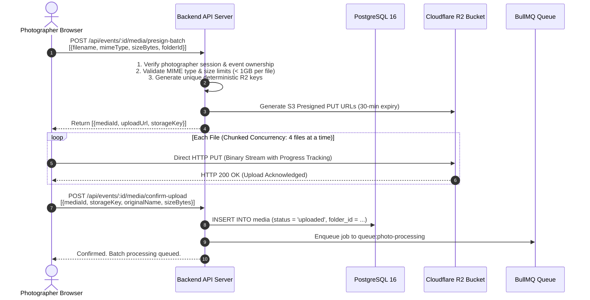
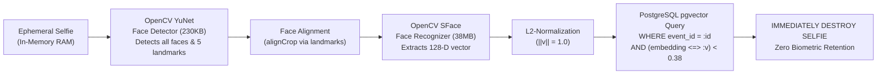
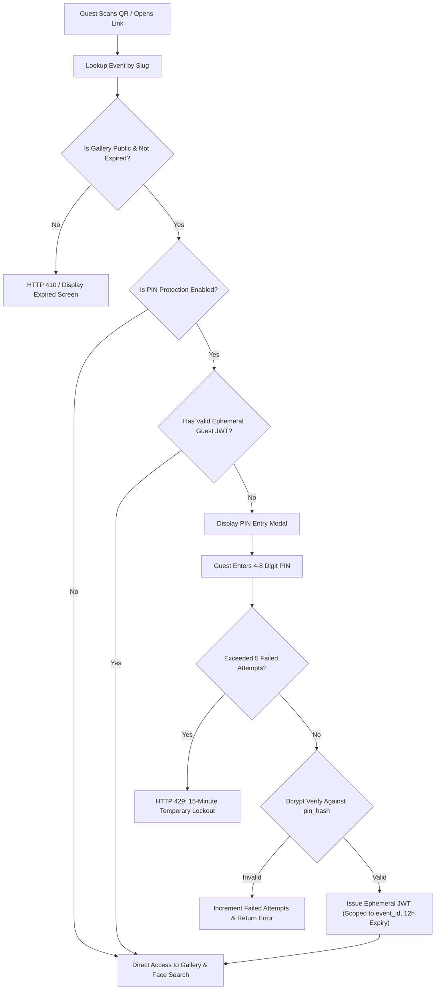
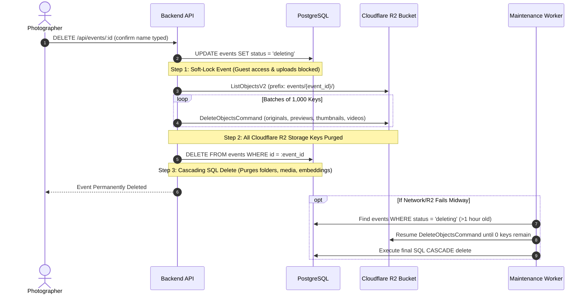
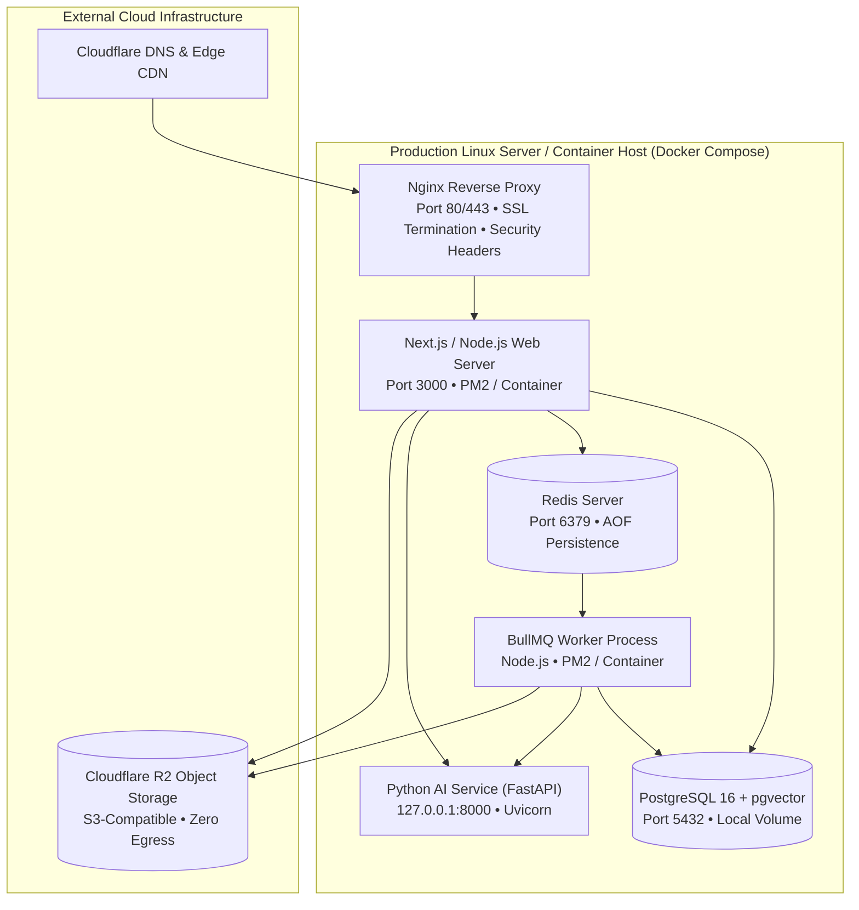

# TECHNICAL ARCHITECTURE & SYSTEM DESIGN SPECIFICATION

**Document Version:** 1.0.0 (Phase 1 Final Architecture)  
**System Classification:** Single-Tenant Professional Photography & Biometric Platform  
**Target User:** Exactly One Authenticated Professional Fine-Art & Commercial Photographer (Sole Owner)  
**Guest Model:** Zero-Account, Mobile-First, Event-Scoped Guests  
**Governing Rules:** Strictly governed by `AGENTS.md` and `docs/PRODUCT_REQUIREMENTS.md`  
**Architecture Decisions:** Formally documented in `docs/architecture-decisions/` (ADR-001 through ADR-012)  

---

## 1. Executive Summary & Architectural Philosophy

The platform is a purpose-built, high-performance photography gallery management and AI-powered biometric face-search platform engineered exclusively for **ONE** professional photographer. The platform bridges the demanding production workflows of professional photography (handling batch uploads of 1,000 to 5,000+ high-resolution RAW/JPEG photos per wedding or event) with high-speed, frictionless, mobile-first guest delivery.

### 1.1 Architectural Balance: Avoiding Both Extremes
1. **Avoiding Under-Engineering:**
   - No blocking synchronous uploads through the web server.
   - No synchronous image resizing or AI facial inference in HTTP request threads.
   - No client-side-only security or unhashed PINs.
   - No fake storage plans or mock billing quotas.
   - No monolithic unstructured database models without vector acceleration.
2. **Avoiding Over-Engineering:**
   - No Kubernetes clusters or microservice meshes.
   - No multi-tenant organizations, staff sub-accounts, or SaaS subscription billing tiers.
   - No Kafka or complex event-sourcing brokers where Redis + BullMQ provides superior simplicity and reliability.
   - No third-party facial recognition SaaS APIs (which violate privacy and incur steep per-image charges).

---

## 2. Direct Answers to Core Architectural Questions

| Question | Architectural Decision & Implementation | Cross-Reference |
| :--- | :--- | :--- |
| **Technologies used?** | Next.js / Node.js (TypeScript), PostgreSQL 16+ with `pgvector`, Redis + BullMQ, Python (FastAPI, OpenCV YuNet & SFace), Cloudflare R2, Sharp. | ADR-001 |
| **Frontend/backend communication?** | RESTful JSON over HTTPS, strict typed DTOs, ephemeral guest JWTs, and pre-signed S3 URLs. | ADR-002, ADR-003 |
| **Authentication?** | Single-owner bcrypt password authentication issuing secure HTTP-only JWT cookies. Zero multi-tenant roles. | ADR-003, Phase 4 |
| **Database?** | Single PostgreSQL 16+ instance hosting both relational entities and 128-D dense vector embeddings via `pgvector`. | ADR-004 |
| **Events and folders?** | Relational hierarchy. Folders are flat logical groupings within an event. Folder IDs on media are nullable for safe folder deletion. | ADR-004, ADR-006 |
| **Cloudflare R2?** | S3-compatible object storage owned directly by the photographer ($0.00 egress). Deterministic key hierarchy. | ADR-006 |
| **Large uploads?** | Direct browser-to-R2 via pre-signed S3 `PutObject` URLs. Application server never buffers multi-gigabyte binaries. | ADR-006, Phase 10 |
| **Background processing?** | Redis + BullMQ with dedicated partitioned queues for photo resizing, facial indexing, video, ZIPs, and maintenance sweeps. | ADR-005 |
| **Python AI service communication?** | Lightweight persistent Python microservice communicating over local HTTP (`127.0.0.1:8000`). Pre-loaded ONNX models. | ADR-007 |
| **Face embeddings storage?** | Stored in `face_embeddings` table with `embedding vector(128)`, indexed via HNSW with cosine distance operator. | ADR-004, ADR-007 |
| **Face search?** | Ephemeral selfie in RAM -> YuNet detect -> SFace 128-D vector -> event-scoped SQL query `WHERE event_id = :id AND (embedding <=> :v) < 0.38`. | ADR-007, ADR-009 |
| **Guest access?** | Zero registration, zero accounts. Access via unique URL slug or QR code. Optional PIN gates an ephemeral signed JWT. | ADR-008 |
| **PIN-protected galleries?** | Salted bcrypt hash (`pin_hash`). IP rate-limiting (max 5 attempts/15 min). Ephemeral 12-hour signed guest session token. | ADR-008 |
| **Public expiry?** | Hard upper limit of 30 days. Automated BullMQ cron sweeper (every 15 min) + reactive request-time guard. Expiry transitions to `private`; NEVER deletes media. | ADR-011 |
| **Downloads?** | Authorized single photo downloads via pre-signed R2 GET URLs. Large bulk downloads via background streaming ZIP on R2. | ADR-010 |
| **Deletion?** | Two-phase soft-lock: set `status = 'deleting'`, purge all R2 objects under prefix, then execute cascading SQL delete. Nightly orphan recovery. | ADR-012 |
| **Event isolation?** | Enforced simultaneously at 5 layers: API routes, authorization middleware, SQL queries (`WHERE event_id = ?`), vector search, and R2 key prefixes. | ADR-009 |
| **Concurrent guests?** | 500 concurrent guest face searches run in < 250ms against pgvector HNSW, completely isolated from background batch image indexing queues. | ADR-005, ADR-007 |
| **Deployment?** | Single production Linux VPS or container host (Docker Compose) behind Nginx reverse proxy with TLS 1.3. Managed Postgres + Redis. | Section 17 |
| **Failure handling?** | Idempotent jobs, automatic BullMQ retry with exponential backoff, R2 orphan reconciliation worker, soft-locked deletion state machines. | ADR-012, Section 15 |
| **Monitoring?** | Structured JSON logging with `requestId` and `jobId`, `/api/health` probes for DB, Redis, R2, and AI daemon. Zero sensitive data logged. | Section 19 |
| **Maintainability?** | Modular domain-driven service architecture, strict TypeScript schemas, zero unnecessary microservices or distributed meshes. | ADR-001, ADR-003 |

---

## 3. High-Level System Architecture

```mermaid
graph TD
    subgraph Clients["Client Access Layer"]
        Photographer["Photographer (Desktop / Laptop)<br/>Sole Authenticated Owner"]
        Guest["Event Guests (Mobile QR / Web)<br/>Zero-Account Ephemeral Access"]
    end

    subgraph Edge["Edge & Delivery Tier"]
        Cloudflare["Cloudflare Edge Network / CDN<br/>TLS 1.3 • WebP Caching • Zero Egress"]
        R2[("Cloudflare R2 Object Storage<br/>events/{id}/originals|previews|thumbnails")]
    end

    subgraph AppHost["Application Server (Node.js / Next.js TypeScript)"]
        Router["App Router & Security Middleware"]
        AuthModule["Photographer Auth (JWT/Bcrypt)"]
        EventModule["Event & Folder Engine"]
        MediaModule["Direct-to-R2 Upload Presigner"]
        GuestModule["Guest PIN & Ephemeral Session Engine"]
        SearchModule["Real-Time Face Search Dispatcher"]
        ExpiryGuard["Public 30-Day Expiry Guard"]
    end

    subgraph CoreStorage["Primary Data Tier"]
        Postgres[("PostgreSQL 16 + pgvector<br/>Relational Tables + 128-D HNSW Vector Index")]
        RedisBroker[("Redis Broker & State Cache<br/>BullMQ Queues + IP Rate Limiter")]
    end

    subgraph Workers["Asynchronous Background Worker Pool"]
        WorkerService["BullMQ Worker Service (Node.js)"]
        SharpEngine["Sharp Image Processing Engine<br/>WebP 400px Thumbnails • 1600px Previews • Watermark"]
        CronSweeper["Scheduled Cron Sweeper<br/>15-min Expiry • Daily Orphan Reconciliation"]
    end

    subgraph AIService["AI Inference Tier"]
        PyAI["Python AI Microservice (FastAPI)<br/>OpenCV YuNet (Detect) + SFace (Embed)<br/>Preloaded Models • RAM-Only Selfie Processing"]
    end

    Photographer -->|HTTPS / Dashboard| Router
    Guest -->|HTTPS / Guest Gallery| Router
    Guest -.->|Direct CDN Thumbnail/Preview Fetch| Cloudflare
    Cloudflare --> R2

    Router --> AuthModule
    Router --> EventModule
    Router --> MediaModule
    Router --> GuestModule
    Router --> SearchModule
    Router --> ExpiryGuard

    AuthModule --> Postgres
    EventModule --> Postgres
    MediaModule --> Postgres
    MediaModule -->|Generate Presigned S3 URLs| R2
    GuestModule --> Postgres
    GuestModule --> RedisBroker
    SearchModule --> Postgres
    SearchModule -->|Direct Local Socket (<80ms)| PyAI

    MediaModule -->|Enqueue Processing Jobs| RedisBroker
    RedisBroker --> WorkerService
    WorkerService --> SharpEngine
    WorkerService -->|Batch Face Indexing| PyAI
    WorkerService --> Postgres
    WorkerService --> R2
    CronSweeper --> RedisBroker
```

---

## 4. Frontend Architecture

### 4.1 Route Segregation & Boundaries
The frontend uses the Next.js App Router with strict route-group segregation to guarantee that guest gallery bundles never leak photographer dashboard code or administrative logic:

```
client/ (or app/)
├── (photographer)/
│   └── dashboard/
│       ├── layout.tsx         # Enforces photographer session, navigation, metrics strip
│       ├── page.tsx           # Dashboard overview, active processing meters, recent events
│       ├── events/
│       │   ├── page.tsx       # Event list, status filters (active/archived), search
│       │   └── [id]/          # Event workspace: folder tabs, media grid, upload dropzone, settings
│       ├── storage/           # Cloudflare R2 measured byte metrics & billing navigation
│       └── settings/          # Studio profile branding, credentials, watermark defaults
│
├── (guest)/
│   └── gallery/
│       └── [shareToken]/
│           ├── layout.tsx     # Clean editorial presentation, zero admin controls
│           ├── page.tsx       # Hero cover, ceremony folder tabs, responsive photo grid
│           └── loading.tsx    # Hairline skeleton shimmer
│
└── api/                       # API route proxies / endpoints
```

### 4.2 Server vs. Client Component Boundaries
- **Server Components:** Utilized for static layout shells, SEO metadata, and dynamic OpenGraph social sharing meta tags (e.g., rendering the wedding couple's name and cover photo preview when an event link is shared on iMessage, WhatsApp, or Instagram).
- **Client Components (`'use client'`):**
  - `BatchUploader.tsx`: Multi-file drag-and-drop uploader with chunked concurrency, per-file byte progress meters, pause/cancellation, and error recovery.
  - `PhotoGrid.tsx`: Fluid masonry grid using CSS column/grid layout and windowing virtualization to support 5,000+ photo collections at 60fps.
  - `LightboxViewer.tsx`: Touch-friendly fullscreen viewer supporting pinch-to-zoom, keyboard navigation, EXIF camera metadata panel, and authorized download actions.
  - `FaceSearchModal.tsx`: Real-time camera capture interface with camera switching (front/back), live framing guide, portrait upload fallback, and biometric zero-retention advisory notice.
  - `PinEntryModal.tsx`: Elegant 4-to-8 digit PIN pad with rate-limit cooldown timer and shake animation on invalid entry.

### 4.3 Data Fetching & Caching Strategy
- **Dashboard Data:** Fetched with `cache: 'no-store'` or short SWR (stale-while-revalidate) revalidation to guarantee immediate visibility into active upload processing jobs and status transitions.
- **Guest Gallery Metadata:** Cached at the edge CDN with `Cache-Control: public, s-maxage=300, stale-while-revalidate=600`.
- **Media Derivative Assets:** Served with immutable cache headers `Cache-Control: public, max-age=31536000, immutable`.
- **Search Responses:** Strictly `Cache-Control: no-store, private` to prevent biometric search results from leaking across users or events.

---

## 5. Backend Architecture & Domain Services

### 5.1 Layered Domain Architecture
The backend follows a strict Layered Service Pattern:

```
src/
├── api/
│   ├── middlewares/       # RequestId, AuthGuard, GuestTokenGuard, RateLimiter, ErrorHandler
│   └── routes/            # Thin HTTP controllers mapping requests to domain services
├── core/
│   ├── domains/           # Pure business logic per functional domain
│   │   ├── auth/          # Photographer password hashing, session tokens, profile
│   │   ├── events/        # Event lifecycle, slug generation, public window enforcement
│   │   ├── folders/       # Ceremony folder CRUD & safe deletion reassignment
│   │   ├── media/         # Pre-signed upload handshakes, metadata, derivative records
│   │   ├── storage/       # R2 byte calculation, reconciliation, Cloudflare navigation
│   │   ├── guest/         # Public event lookup, PIN verification, ephemeral guest tokens
│   │   ├── ai/            # Facial vector inference orchestration & event-scoped vector queries
│   │   ├── downloads/     # Single authorized downloads & streaming ZIP packaging
│   │   └── qr/            # Vector SVG and high-resolution PNG QR generation
│   ├── repositories/      # SQL data access layer executing parameterized queries
│   └── services/          # Infrastructure adapters (R2 S3Client, BullMQ Queues, Python AI Client)
└── shared/
    ├── types/             # Domain entity interfaces, Zod schemas, DTOs
    ├── errors/            # Standardized AppError hierarchy
    └── utils/             # Crypto, formatting, structured logging
```

### 5.2 Standardized API Response & Error Contract
All API responses conform to a predictable envelope:

```typescript
// Success Envelope
interface ApiSuccessResponse<T> {
  success: true;
  data: T;
  meta?: {
    page?: number;
    limit?: number;
    total?: number;
    requestId: string;
  };
}

// Error Envelope
interface ApiErrorResponse {
  success: false;
  error: {
    code: string;       // e.g., 'GALLERY_EXPIRED', 'PIN_REQUIRED', 'RATE_LIMITED'
    message: string;    // Human-readable message
    details?: unknown;  // Validation field errors (omitted in production for security)
    requestId: string;
  };
### 5.3 Event Lifecycle, Ownership Scoping & Isolation Architecture (Phase 6)
- **Sole-Owner Scoping & IDOR Prevention:**
  - The platform is engineered exclusively for one authenticated photographer (`AGENTS.md`).
  - Owner identity is derived strictly from the verified session token (`req.photographer.id`). Client-provided `owner_id` values are never trusted or accepted.
  - Every event query and mutation enforces:
    ```sql
    WHERE id = :eventId AND owner_id = :authenticatedOwnerId
    ```
  - Unauthorized queries return `404 EVENT_NOT_FOUND` to prevent IDOR scanning and enumeration.
- **Dual-State Decoupling:**
  - **Lifecycle (`status`):** `draft` (initial unlisted container) $\to$ `active` (operational) $\to$ `archived` (preserved historical container) $\to$ `deleting` (ephemeral soft-lock during permanent deletion).
  - **Visibility (`visibility`):** `private` (default safe state) vs. `public` (accessible to guests within window).
- **30-Day Maximum Public Availability:**
  - Enforced strictly on backend: `public_until - public_from <= 30 days` (2,592,000 seconds).
- **PIN Protection:**
  - 4-8 digit numeric PINs are hashed with salted bcrypt (cost 10) upon entry and stored in `pin_hash`.
  - Raw PINs and hashes are never exposed in logs, responses, or client payloads.

### 5.4 Folder Management Subsystem & Media Isolation Architecture (Phase 7)
- **Flat Event-Scoped Hierarchy:**
  - Folders represent ceremony/category partitions strictly contained within a single event (e.g., *Haldi*, *Ceremony*, *Reception*).
  - No nested sub-folders or cross-event folder trees are permitted, keeping navigation intuitive, mobile-performant, and structurally isolated.
  - Folder uniqueness is scoped per event (`UNIQUE(event_id, name)`), allowing identical folder names (such as "Ceremony") across distinct client galleries.
- **Strict Event Isolation & Anti-Leakage Defense:**
  - All folder queries require parent event authorization: `WHERE event_id = :eventId`.
  - Media moving (`PATCH /events/:eventId/media/:mediaId/folder` and `POST /events/:eventId/media/move-batch`) performs strict relational validation:
    1. The target folder MUST belong to the specified event (`folder.event_id === eventId`).
    2. The media items MUST belong to the specified event (`media.event_id === eventId`).
    3. Any attempt to move media to a folder in another event is rejected with `400 INVALID_TARGET_FOLDER` at the service layer, preventing cross-event contamination.
- **Safe Folder Deletion Engine:**
  - Under no circumstances does deleting a folder destroy or remove photographic or video assets.
  - The deletion pipeline executes atomically in a managed database transaction (`withTransaction`):
    1. Uncouples all media belonging to the folder: `UPDATE media SET folder_id = NULL, updated_at = NOW() WHERE event_id = $1 AND folder_id = $2`.
    2. Deletes the folder entity: `DELETE FROM folders WHERE id = $1 AND event_id = $2`.
  - Reassigned media immediately falls back to the event's root uncategorized collection.
  - Database-level foreign key constraint `media.folder_id REFERENCES folders(id) ON DELETE SET NULL` acts as an invariant safety net.

---

## 6. Cloudflare R2 Storage Architecture

### 6.1 Ownership Model & Zero-Egress Economics
- Cloudflare R2 is the primary object storage for all photographs, videos, and generated derivatives.
- The photographer owns the Cloudflare account and bucket directly.
- **Zero Egress Fees:** Cloudflare R2 charges $0.00 per GB of egress bandwidth. When 500 guests browse high-resolution galleries or download full-size photo masters, the photographer pays exactly $0 in data transfer fees (compared to AWS S3, which would cost hundreds of dollars per event).

### 6.2 Deterministic Key Hierarchy
All storage object keys adhere to a deterministic, event-partitioned structure:

```
events/
└── {event_id}/
    ├── originals/
    │   └── {filename}.{ext}       # Untouched master file (full camera resolution)
    ├── previews/
    │   └── {filename}.webp        # Max 1600px WebP (quality 85, watermarked if enabled)
    ├── thumbnails/
    │   └── {filename}.webp        # Max 400px WebP (quality 80, fast grid browsing)
    ├── videos/
    │   └── {filename}.{ext}       # Master video asset
    └── exports/
        └── {job_id}.zip           # Temporary bulk download archive (24-hour TTL)
```

### 6.3 Database-Driven Folder Organization (Architectural Rationale)
Ceremony folders (e.g., *Haldi*, *Mehndi*, *Wedding*, *Reception*) **DO NOT** exist in Cloudflare R2 object keys.
- **Why?** If folder names were encoded into object keys (e.g., `events/{id}/folders/haldi/photo.jpg`), moving 1,000 photos from "Uncategorized" to "Haldi" would require 1,000 S3 `CopyObject` operations followed by 1,000 `DeleteObject` operations in R2, taking several minutes, consuming API rate limits, and risking partial failure.
- **Our Implementation:** Folder categorization is stored strictly in PostgreSQL (`media.folder_id = :folder_id`). Reorganizing photos between folders is an instantaneous single SQL update statement executing in < 5ms with **zero storage I/O**.

### 6.4 Server-Side Storage Adapter & Client Foundation (Phase 8 Implementation)
- **S3 Client Implementation:** Uses official `@aws-sdk/client-s3` and `@aws-sdk/s3-request-presigner` configured for Cloudflare R2 S3-compatible endpoints:
  - Endpoint: `https://${R2_ACCOUNT_ID}.r2.cloudflarestorage.com` (with optional `R2_ENDPOINT` override for local testing/MinIO).
  - Region: `'auto'`.
  - Credentials: `{ accessKeyId, secretAccessKey }` strictly server-side.
  - Connection/Retry: 10-second request timeout, bounded 3-retry attempt with exponential backoff on transient idempotent failures.
- **Storage Adapter Primitives (`StorageAdapter`):**
  - `checkBucketAccess()`: Probes bucket accessibility via `HeadBucketCommand`.
  - `headObject(key)`: Retrieves `StorageObjectMetadata` (`sizeBytes`, `contentType`, `etag`, `lastModified`, `customMetadata`) without downloading binary payloads. Returns `null` on 404/NotFound.
  - `objectExists(key)`: Fast boolean existence check.
  - `putObject(key, body, contentType, metadata)`: Direct stream/buffer storage for worker/service routines.
  - `deleteObject(key)`: Idempotent object purge (`DeleteObjectCommand`).
  - `generatePresignedPutUrl(options)`: Generates scoped presigned PUT upload URLs with bounded TTL (60s–3600s).
  - `generatePresignedGetUrl(options)`: Generates scoped presigned GET URLs for temporary delivery/downloads with bounded TTL (60s–3600s).
- **Separation of Concerns:** The storage adapter executes pure storage primitives. Application authentication and event authorization are strictly evaluated by caller services *before* invoking storage operations.

### 6.5 Presigned URL Policy & Redacted Observability
- **Short-Lived Bearer Capabilities:** Presigned URLs expire strictly between 60 and 3600 seconds (default 900 seconds / 15 minutes).
- **Zero Permanent Storage of Signed URLs:** Presigned URLs are ephemeral capabilities generated on demand; they are NEVER persisted in PostgreSQL columns or metadata.
- **Secret Redaction in Logs:** All logging through `logger` automatically scrubs `X-Amz-Signature`, `X-Amz-Credential`, and sensitive query parameters via `redactUrlForLogs()`. Full credentials and raw file buffers are never written to log sinks.

### 6.6 PostgreSQL & Cloudflare R2 Consistency Model
- **Non-Atomic Boundary:** PostgreSQL transactions and Cloudflare R2 operations do NOT form a distributed 2PC (Two-Phase Commit). A database write can succeed while an R2 call fails, or an R2 object can upload while network disconnects before database finalization.
- **Consistency Strategy:**
  - Database status transitions (`uploaded` $\to$ `processing` $\to$ `ready` $\to$ `failed`).
  - Pre-signed upload handshakes generate deterministic keys; database registration occurs only upon upload confirmation (`confirm-upload`).
  - Orphaned objects are purged via scheduled background reconciliation (Phase 25) rather than relying on assumed atomicity.
  - Missing R2 objects during `headObject` return `null` explicitly rather than crashing application queries.

### 6.7 Storage Management & Cloudflare Navigation Architecture (Phase 9)
- **Clear Measurement Boundaries:**
  - **Application-Tracked Storage:** The aggregate byte sum of all media assets cataloged in PostgreSQL (master originals, generated 1600px previews, 400px thumbnails, and video assets).
  - **Cloudflare Bucket Usage:** The raw byte volume measured directly across the Cloudflare R2 bucket.
  - **Cloudflare Billable Usage:** The actual billing calculated by Cloudflare under the photographer's direct account terms ($0 egress, first 10 GB free, $0.015/GB-mo thereafter).
- **Dual Data Source Calculation:**
  - Queries `storage_usage` table records first (populated by seeds or background workers).
  - Automatically falls back to computing live aggregates directly from `media.file_size` if `storage_usage` records are absent.
  - Evaluates data staleness: `isStale = true` if `last_calculated_at` is older than 24 hours or if newer media has been inserted since the calculation timestamp.
- **Zero Fake Quotas & Anti-Reseller Rule:**
  - The application strictly prohibits displaying arbitrary capacity tiers (e.g., "50 GB plan" or "80% of quota used").
  - Only actual measured consumption is displayed without artificial progress bars or upgrade prompts.
- **Secure Cloudflare Navigation:**
  - The backend generates sanitized external URLs targeting the photographer's direct Cloudflare destination:
    - R2 Bucket: `https://dash.cloudflare.com/:accountId/r2/default/buckets/:bucketName`
    - Billing: `https://dash.cloudflare.com/:accountId/billing`
  - Fallback: Defaults safely to `https://dash.cloudflare.com` if account ID is unconfigured or non-hex, never exposing credentials in URLs.

---

## 7. Direct-to-R2 Upload Architecture

Large media batches never proxy their multi-gigabyte binary streams through the application server:



### 7.1 Upload Resilience & Abandoned File Cleanup
- If an upload fails during the PUT request, the browser retries up to 3 times with exponential backoff.
- If the browser closes before calling `/confirm-upload`, the uploaded binary in R2 has no database record. The nightly maintenance worker detects any R2 objects under `events/{id}/originals/` older than 4 hours with no corresponding `media` row and purges them.

### 7.2 Phase 10 Production-Ready Upload Engine Implementation
- **Transport Method:** Direct-to-R2 transfer via AWS S3 Presigned `PutObjectCommand` URLs. Eliminates memory buffering and multipart complexity on the API server.
- **Concurrency & Client Queue:** Bounded client concurrency (`DEFAULT_CONCURRENCY = 4`) running over `XMLHttpRequest` for accurate per-file `onprogress` tracking, cancellation via `abort()`, and independent failed-file retries.
- **Validation Pipeline:**
  - Extensions & MIME: Strictly accepts `image/jpeg`, `image/png`, `image/webp`. Rejects SVG (`415 UNSUPPORTED_MEDIA_TYPE`) and HEIC/HEIF with actionable guidance.
  - Size & Batch: Max 100 MB per photo (`MAX_PHOTO_SIZE_BYTES`), max 500 photos per batch (`MAX_UPLOAD_BATCH_SIZE`).
  - Scoping & IDOR: Strictly validates event ownership and folder-to-event containment (`folder.event_id === eventId`), preventing cross-event leakage.
- **Verification & Idempotency:**
  - Confirmation (`POST /api/events/:eventId/media/confirm-upload`) probes Cloudflare R2 via `headObject(storageKey)` before writing database rows.
  - Inserts original photo record with `status = 'uploaded'`. Repeated calls return existing confirmed record without creating duplicate entries or inflating storage usage.

---

## 8. Image & Video Processing Pipeline

### 8.1 Image Processing Pipeline (Sharp)
1. **Worker Pickup:** The BullMQ worker receives a `media_id` job from `queue:photo-processing`.
2. **Streaming Ingestion:** Worker streams the original master from R2 into a RAM buffer.
3. **EXIF Parsing:** Sharp extracts camera metadata: make, model, lens, exposure time, aperture (f-number), ISO, focal length, and original capture timestamp.
4. **Thumbnail Generation:**
   - Resized to max 400px width/height (preserving aspect ratio).
   - Encoded as WebP at quality 80 with smart subsampling.
   - Streamed to `events/{event_id}/thumbnails/{filename}.webp`.
5. **Preview Generation & Watermarking:**
   - Resized to max 1600px width/height.
   - If the event has `watermark_enabled = true`, Sharp composites an elegant, semi-transparent typographical studio watermark overlay onto the bottom-right corner.
   - The **original master remains 100% untouched and clean**.
   - Streamed to `events/{event_id}/previews/{filename}.webp`.
6. **Hand-off to AI:** The worker updates `media.status = 'ready'` and immediately enqueues a job to `queue:face-indexing`.

### 8.2 Video Processing Pipeline (Non-Blocking)
- Video processing is isolated in `queue:video-processing` with a concurrency limit of 1 worker so heavy video encoding never starves photo processing.
- Generates an optimized WebP poster frame from second 1.0 of the video and uploads it to the thumbnails key.
- Validates MP4/MOV container formatting for smooth HTML5 video playback.

---

## 9. Background Job & Queue Architecture (Redis + BullMQ)

### 9.1 Partitioned Queues & Concurrency Matrix

| Queue Name | Primary Responsibility | Concurrency | Priority | Retry Strategy |
| :--- | :--- | :--- | :--- | :--- |
| `queue:photo-processing` | Sharp thumbnail/preview generation, EXIF parsing | 4 workers | 5 (Normal) | 3 retries, exponential backoff (2s, 8s, 30s) |
| `queue:face-indexing` | Python AI service face detection & 128-D vector extraction | 2 workers | 5 (Normal) | 2 retries, linear backoff (5s) |
| `queue:video-processing` | Video validation, poster generation, metadata extraction | 1 worker | 1 (Low) | 2 retries |
| `queue:zip-generation` | Asynchronous bulk ZIP archive packing | 2 workers | 10 (High) | 1 retry (fail fast) |
| `queue:gallery-expiry` | Automated 30-day public visibility enforcement sweep | 1 worker | Scheduled | Cron: every 15 minutes |
| `queue:maintenance` | R2 orphan object cleanup & storage byte reconciliation | 1 worker | 1 (Low) | Cron: daily at 03:00 UTC |

### 9.2 Interactive Search Isolation Guarantee
Guest **"Find My Photos"** face searches bypass BullMQ background queues entirely. When a guest submits a selfie:
- The API server routes the ephemeral selfie image directly to the running Python AI Service via low-latency local HTTP/socket.
- The Python service extracts the 128-D vector in ~80ms.
- PostgreSQL queries the HNSW index filtered by `event_id` in ~15ms.
- Total round-trip latency is **< 250ms**, completely unaffected by whether 5,000 photos are currently queued in `queue:photo-processing`.

---

## 10. AI Biometric Face Recognition Architecture



### 10.1 Model Specifications
1. **Face Detector (YuNet):**
   - ONNX Model: `face_detection_yunet_2023mar.onnx` (OpenCV Zoo).
   - Ultra-lightweight CNN (~230 KB), sub-30ms inference on standard x86/ARM CPU.
   - Extracts bounding box `[x, y, w, h]` and 5 facial landmarks (right eye, left eye, nose tip, right mouth corner, left mouth corner).
   - Score threshold: 0.70; NMS threshold: 0.30.
2. **Face Recognition & Alignment (SFace):**
   - ONNX Model: `face_recognition_sface_2021dec.onnx` (OpenCV Zoo).
   - Deep CNN (~38 MB), sub-50ms inference on CPU.
   - Aligns facial orientation via detected landmarks.
   - Outputs a **128-dimensional L2-normalized vector embedding**.
   - Metric: Cosine similarity (`dot product` of normalized vectors, range -1.0 to 1.0).
   - **Calibrated Match Threshold:** Cosine similarity >= 0.62 (equivalent to cosine distance <= 0.38).

### 10.2 Group Photo Matching Strategy
In a photo with multiple individuals (e.g., 8 people in a bridal party):
- YuNet detects all 8 faces.
- SFace produces 8 independent embedding records in `face_embeddings`, all linked to the same `photo_id` and `event_id`.
- If an event guest matches Face #4, the query matches that record and returns the parent `photo_id`.
- The **complete group photograph is returned** in the guest's search results.

### 10.3 Biometric Zero-Retention Protocol
Guest selfies represent highly sensitive biometric data:
1. Ingested ephemerally into server RAM (or temporary encrypted scratch file).
2. Converted into 128-D mathematical vector coordinates.
3. Raw selfie is **permanently destroyed/unlinked** within milliseconds.
4. No raw guest selfies are ever written to Cloudflare R2 or persistent databases.

### 10.4 Extensible Model Abstraction Architecture
To prevent tight coupling between the application and specific deep learning weights:
- **`BaseFaceDetector(ABC)`**: Abstract contract requiring `detect_faces(image_bgr) -> List[DetectedFace]`. Returns normalized bounding boxes `[x, y, w, h]`, confidence scores, and 5 landmark coordinates. Implemented by `YuNetFaceDetector`.
- **`BaseFaceRecognizer(ABC)`**: Abstract contract requiring `extract_embedding(image_bgr, face_info) -> np.ndarray`. Accepts cropped/aligned faces and returns unit-normalized embeddings of fixed dimensions (128-D). Implemented by `SFaceFaceRecognizer`.
- **`BiometricEngine` Singleton**: Process-level singleton loading ONNX weights once during startup, caching inference sessions across all worker tasks. Exposes `get_model_info()` documenting model name, version, embedding dimensions (128), and licensing.
- **Provider Interchangeability**: New commercial models (e.g., future lightweight ONNX models) can be swapped by implementing `BaseFaceDetector` or `BaseFaceRecognizer` without modifying database schemas, API routes, or vector indexes.

### 10.5 Verified Commercial Licensing
All deep learning components in the biometric pipeline are rigorously verified for commercial use:
- **YuNet Face Detector:** Developed by Shiqi Yu / OpenCV Zoo (`face_detection_yunet_2023mar.onnx`). Licensed under MIT License / Apache 2.0.
- **SFace Face Recognizer:** Developed by Zhong et al. / OpenCV Zoo (`face_recognition_sface_2021dec.onnx`). Licensed under Apache 2.0 / BSD 3-Clause.
- **Strict Compliance Rule:** Pretrained weights with non-commercial restrictions (such as InsightFace / ArcFace original weights under CC-BY-NC-4.0) are strictly prohibited from this codebase.

### 10.6 Reusable Embedding Lifecycle & Zero Re-Indexing
- **Process Once, Query Infinitely:** Every event photograph is processed exactly once upon upload. Its detected face embeddings are persisted in Supabase PostgreSQL (`face_embeddings` table) alongside deterministic photo and event foreign keys.
- **pgvector Cosine Search Acceleration:** An HNSW index (`USING hnsw (embedding vector_cosine_ops)`) indexes all stored vectors.
- **Query Execution:** When a guest uploads a selfie, only the single query selfie is processed to extract a temporary 128-D vector. Vector similarity search executes against pre-computed database embeddings:
  ```sql
  SELECT m.id, m.storage_key_thumbnail, 1 - (fe.embedding <=> $1::vector) AS similarity
  FROM face_embeddings fe
  JOIN media m ON m.id = fe.photo_id
  WHERE fe.event_id = $2 AND m.event_id = $2 AND m.status = 'ready'
    AND (fe.embedding <=> $1::vector) < 0.38
  ORDER BY fe.embedding <=> $1::vector ASC
  LIMIT 50;
  ```
- **Zero Photo Re-indexing:** Zero event photographs are re-read, re-decoded, or re-processed during guest searches. Thousands of guests can search the same event with O(log N) vector index lookups.

### 10.7 Internal Photo Indexing & Asynchronous Job Recovery
- **Decoupled Job Enqueue:** `POST /internal/index-photo` accepts authorized requests to enqueue face indexing jobs without blocking HTTP request threads.
- **Job Observability & Retry:** `GET /internal/index-jobs/:job_id` provides real-time job state (`waiting`, `active`, `completed`, `failed`), and `POST /internal/index-jobs/:job_id/retry` enables safe retries of failed indexing tasks.
- **Idempotency Guarantee:** Retrying an indexing job safely updates or cleans up existing embeddings for that photo to prevent duplicate vector rows.

---

## 11. Guest Authorization & Event PIN Model

Guests do not have accounts, usernames, or dashboards. Access is strictly scoped to an individual event via its unique shareable URL slug or QR code (`/gallery/:shareToken`):



### 11.1 Ephemeral Guest Session Token
When PIN verification succeeds, the backend issues an ephemeral signed JWT:
```json
{
  "eventId": "9b1deb4d-3b7d-4bad-9bdd-2b0d7b3dcb6d",
  "scope": "guest_gallery_access",
  "iat": 1775630400,
  "exp": 1775673600
}
```
- Transmitted in the request header: `X-Guest-Token: <token>`.
- **Strict Scope Enforcement:** The guest token grants access ONLY to endpoints where `:eventId` matches `token.eventId`. It provides zero access to photographer dashboard endpoints or other events.

---

## 12. Strict Multi-Tier Event Isolation Architecture

Every event is an independent container. Guests from Event A must NEVER access photos, folders, face embeddings, or metadata from Event B:

```
┌────────────────────────────────────────────────────────┐
│ 1. API Route Layer: Event Context Extraction & Token Match │
└──────────────────────────┬─────────────────────────────┘
                           ▼
┌────────────────────────────────────────────────────────┐
│ 2. Authorization Layer: Strict Event Ownership & Scopes│
└──────────────────────────┬─────────────────────────────┘
                           ▼
┌────────────────────────────────────────────────────────┐
│ 3. Database Layer: Parameterized SQL WHERE event_id = ? │
└──────────────────────────┬─────────────────────────────┘
                           ▼
┌────────────────────────────────────────────────────────┐
│ 4. Vector AI Layer: Partitioned Similarity Query        │
└──────────────────────────┬─────────────────────────────┘
                           ▼
┌────────────────────────────────────────────────────────┐
│ 5. Object Storage Layer: Deterministic Key Prefixes     │
└────────────────────────────────────────────────────────┘
```

1. **API Layer:** Handlers resolve event context from the URL slug. If an operation references a media ID or folder ID, the system validates that the resource belongs to the current event.
2. **Authorization Layer:** Middleware verifies that guest tokens match the route event ID.
3. **Database Layer:** Every repository query mutating or selecting photos, folders, or embeddings enforces `WHERE event_id = :target_event_id`.
4. **Vector Search Layer:** Face search queries vector indexes constrained strictly to the event ID:
   ```sql
   SELECT photo_id, 1 - (embedding <=> $selfie_vector) AS score
   FROM face_embeddings
   WHERE event_id = $current_event_id  -- STRICT EVENT BOUNDARY
     AND (embedding <=> $selfie_vector) < 0.38
   ORDER BY embedding <=> $selfie_vector ASC;
   ```
5. **Storage Layer:** Object keys are prefixed with `events/{event_id}/`. Pre-signed URLs strictly specify keys within that prefix.

---

## 13. Gallery Public/Private Lifecycle & 30-Day Expiry

### 13.1 Clear State Separation
The platform strictly separates three distinct lifecycle concepts:
1. **Lifecycle Status (`status`):** `active` (operational), `archived` (hidden from dashboard views), or `deleting` (locked for permanent deletion).
2. **Gallery Visibility (`visibility`):** `public` (accessible via share link/QR) or `private` (accessible exclusively by the photographer).
3. **Processing Status (`processing_status` on media/jobs):** `uploaded`, `processing`, `ready`, `failed`.

### 13.2 Automated Expiry Architecture
- **30-Day Hard Upper Bound:** When an event is published, the backend strictly validates that `public_until - public_start <= 30 days`.
- **Proactive Sweeper:** BullMQ cron job runs every 15 minutes, executing:
  ```sql
  UPDATE events 
  SET visibility = 'private' 
  WHERE visibility = 'public' AND public_until < NOW();
  ```
- **Reactive Request Guard:** Every guest API endpoint checks `if (event.public_until && event.public_until < now)` and returns `HTTP 410 Gone` immediately, eliminating any window of vulnerability between sweeper runs.
- **ZERO DATA LOSS GUARANTEE:** Expiry transitions visibility from `public` to `private`. Photos, videos, embeddings, folders, and photographer access remain 100% intact. The photographer can reactivate public viewing at any time.

---

## 14. Media Download Architecture

```
Guest Requests Download
         │
         ▼
Check events.allow_downloads === true?
   ├── NO  → HTTP 403 Forbidden ("Downloads disabled by photographer")
   └── YES
         ├── Single Photo → Generate Time-Limited Presigned R2 GET URL (Direct from R2)
         └── Bulk ZIP     → Small (<50): Stream ZIP on the fly
                           → Large (>50): Enqueue queue:zip-generation -> Temporary R2 ZIP (24h TTL)
```

- When downloads are disabled by the photographer, no download controls or URLs are served.
- Full-resolution originals are delivered via signed Cloudflare R2 URLs with `response-content-disposition=attachment`, offloading all download bandwidth from the application server with zero egress fees.

---

## 15. Permanent Deletion & Cross-System Data Consistency

Because the application spans PostgreSQL, Redis, and Cloudflare R2, deletions cannot be wrapped in a single distributed database transaction. We implement a **Two-Phase Soft-Lock Protocol**:



### 15.1 Cross-System Failure Recovery Matrix

| Failure Scenario | Root Cause | Architectural Recovery Strategy |
| :--- | :--- | :--- |
| **R2 Upload Succeeds, Browser Fails Confirmation** | Client network drop after S3 PUT | Nightly maintenance job scans R2 keys with prefix `events/{id}/originals/` older than 4 hours with no matching `media` row and deletes them. |
| **Worker Crashes During Image Processing** | Server OOM / restart | BullMQ automatically detects stalled job lock, releases it, and retries on an available worker with exponential backoff. |
| **AI Indexing Fails on Corrupt Photo** | Malformed image encoding | Job caught in BullMQ; `media.status` set to `'ready'` (without faces); error logged in `processing_jobs.error_message`. |
| **Event Deletion Interrupted Midway** | Network partition during R2 delete | Event remains in `status = 'deleting'`. Maintenance worker detects locked events > 1 hour old and resumes R2 purge until 0 keys remain, then executes DB cascade. |
| **Redis Server Restarts** | System reboot | BullMQ uses Redis AOF (Append-Only File) persistence; active and waiting jobs reload automatically on restart. |

---

## 16. Security & Trust Boundaries

```
[ ZONE 0: Public Internet ]
  Photographer Browsers • Mobile Guest Devices • QR Code Scanners
        │
        ▼ HTTPS / TLS 1.3
[ ZONE 1: Edge & CDN Layer (Cloudflare) ]
  DDoS Protection • WAF • Edge WebP Caching • Zero Egress CDN Delivery
        │
        ▼
[ ZONE 2: Application Boundary (Node.js API Server) ]
  • JWT Session Verification (Photographer)
  • Ephemeral Event Token Verification (Guest)
  • Rate Limiting (IP + Event Slug)
  • Zod Schema Input Validation
  • Pre-Signed S3 URL Token Generation
        │
        ▼ Internal Localhost / Private VPC
[ ZONE 3: Internal Infrastructure ]
  • PostgreSQL 16 + pgvector (Port 5432)
  • Redis Broker (Port 6379, Password Protected)
  • Python AI Microservice (127.0.0.1:8000)
```

---

## 17. Production Deployment Topology



---

## 18. Scalability Strategy & Concurrency Benchmarks

- **Target Workload:** 5,000 photos per event, 500 concurrent guest face searches.
- **De-Coupled Execution:** Face search executes against the PostgreSQL HNSW vector index in < 15ms and Python inference in < 80ms, completely independent of heavy batch image resizing queues.
- **CDN Offloading:** 95%+ of bandwidth (thumbnails and previews) is served directly from Cloudflare R2 / CDN, completely bypassing the application server.
- **Database Tuning:** PostgreSQL connection pooling (PgBouncer), indexed foreign keys, and HNSW vector indexing (`m=16, ef_construction=64`).

---

## 19. Observability & Logging Architecture

### 19.1 Structured Logging Standards
All application and worker logs are formatted as structured JSON:
```json
{
  "timestamp": "2026-10-08T07:30:00.000Z",
  "level": "info",
  "service": "photography-api",
  "requestId": "a1b2c3d4-e5f6-7890",
  "eventId": "9b1deb4d-3b7d-4bad-9bdd-2b0d7b3dcb6d",
  "action": "guest.face_search",
  "durationMs": 142,
  "matchCount": 18
}
```

### 19.2 Strict Biometric & Credential Logging Prohibition
To uphold security and biometric privacy standards, the following data is **STRICTLY PROHIBITED** from appearing in logs or error traces:
- Passwords or password hashes.
- Cloudflare R2 Access Keys or Secret Keys.
- Raw event PINs.
- Raw guest selfie image buffers or base64 strings.
- 128-dimensional biometric face embeddings.
- Full JWT signing secrets or session tokens.

---

## 20. Testing & Verification Architecture

The platform requires a comprehensive testing pyramid across subsequent phases:
1. **Unit Tests (Vitest / Jest):** Pure domain logic (slug generator, expiry calculator, validation schemas, token signers).
2. **Integration Tests:** Database repositories (PostgreSQL + pgvector queries, foreign key cascading, safe folder reassignment), BullMQ worker queue handlers, and R2 S3 adapter mocks.
3. **API Tests (Supertest):** Photographer authentication, event CRUD, guest PIN verification, brute-force rate-limiting, and event isolation verification.
4. **AI Biometric Tests (pytest):** Verification of YuNet face detection accuracy, SFace landmark alignment, 128-D vector normalization (`||v|| = 1.0`), and group photo match verification.
5. **End-to-End Tests (Playwright):** Full browser journeys (Photographer login -> Event create -> Upload batch -> Guest QR scan -> PIN unlock -> Face search selfie capture -> Lightbox view -> Download).
6. **Security & Penetration Tests:** Explicit tests asserting that Event A guests receive `HTTP 403/404` when attempting to access Event B resources.

---

## 21. Summary of Architecture Decision Records (ADRs)

| ADR Number | Title | Core Architectural Decision |
| :--- | :--- | :--- |
| **ADR-001** | Overall Architecture | Modular service-oriented architecture (Node.js/Next.js, Postgres+pgvector, Redis+BullMQ, Python AI, Cloudflare R2). |
| **ADR-002** | Frontend Architecture | Next.js App Router with strict route-group segregation (`/dashboard` vs `/gallery/[shareToken]`). |
| **ADR-003** | Backend Architecture | Layered domain-driven service architecture with Zod validation and standardized AppError hierarchy. |
| **ADR-004** | Database Architecture | PostgreSQL 16+ with `pgvector` HNSW cosine indexing for unified relational and 128-D vector storage. |
| **ADR-005** | Background Job Architecture | Redis + BullMQ partitioned queues with strict isolation between batch uploads and real-time face search. |
| **ADR-006** | R2 Storage Architecture | Direct photographer ownership of Cloudflare R2 ($0 egress), deterministic keys, database-driven folders. |
| **ADR-007** | AI Service Architecture | Persistent Python microservice running OpenCV YuNet + SFace with RAM-only selfie processing (zero retention). |
| **ADR-008** | Guest Authorization Model | Accountless guest model with optional bcrypt PIN verification issuing ephemeral event-scoped JWTs. |
| **ADR-009** | Event Isolation | 5-layer event boundary enforcement (API routes, auth middleware, SQL queries, vector search, storage keys). |
| **ADR-010** | Media Delivery | 3-tier delivery: WebP thumbnails for grids, WebP previews for lightboxes, pre-signed URLs for master originals. |
| **ADR-011** | Gallery Expiry | Hard 30-day limit enforced via BullMQ cron sweeper (15 min) + reactive request-time guard. Never deletes data. |
| **ADR-012** | Deletion & Consistency | Two-phase soft-lock (`status = 'deleting'`), R2 bulk purge, SQL cascade, and nightly orphan reconciliation. |

---

## 22. Phase 5 Frontend Architecture & UI Foundation

### 22.1 Architecture Overview
The photographer dashboard is implemented within `apps/web` utilizing Next.js App Router (React 19) with strict server/client boundary separation.
- **Route Protection:** `/dashboard/*` is wrapped by an authenticated layout (`apps/web/app/dashboard/layout.tsx`) that enforces session validation via `useAuthSession` querying `GET /api/auth/me`. Unauthenticated access redirects immediately to `/login`.
- **Zero Client-Side Credentials:** Storage credentials, database connection strings, and JWT signing keys are completely prohibited from client bundles.
- **API Communication:** All requests route through the Next.js API rewrite proxy (`/api/:path*` -> Express API) with `credentials: 'include'` for secure HttpOnly cookie delivery.

### 22.2 Component Hierarchy & State Isolation
```
apps/web/
├── app/
│   ├── layout.tsx                # Minimal HTML wrapper with font declarations
│   ├── page.tsx                  # Public landing page with fine-art brand aesthetic
│   ├── login/page.tsx            # Photographer authentication gateway
│   └── dashboard/
│       ├── layout.tsx            # Authenticated shell, sidebar, header, session guard
│       ├── page.tsx              # Dashboard overview, architectural pillars, empty events
│       ├── events/page.tsx       # Events workspace placeholder (Phase 6 boundary)
│       ├── storage/page.tsx      # R2 storage metrics & Cloudflare portal link (Phase 8 boundary)
│       └── settings/page.tsx     # Studio profile and live password rotation
├── components/
│   ├── ui/                       # Reusable UI primitives (Button, Card, Badge, Modal, etc.)
│   └── dashboard/                # Application shell components (Sidebar, Header, MobileNav, etc.)
└── lib/
    ├── utils.ts                  # cn() class merging utility (clsx + tailwind-merge)
    └── auth.ts                   # useAuthSession() client state hook & session manager
```

### 22.3 Responsive Layout Strategy
- **Desktop (>= 768px):** Fixed left navigation rail (`w-64`) with brand identity, workspace routes, session status indicator, and photographer profile card. Main workspace scrolls independently.
- **Mobile (< 768px):** Compact top bar with aperture mark, breadcrumbs, and hamburger menu trigger. Sliding drawer menu (`MobileNav`) overlays with full touch-optimized navigation targets and backdrop blur.

---

## 23. Phase 11 Image Processing Pipeline Architecture

### 23.1 Image Transformation Engine
- **Library:** `sharp` (`^0.35.5`) with native libvips hardware acceleration and SIMD.
- **Input Formats:** JPEG, PNG, WebP with strict magic bytes file signature validation.
- **Output Format:** WebP (quality 80 for thumbnails, quality 85 for previews).
- **Metadata Handling:** Strips non-essential EXIF/IPTC metadata on derivative generation while normalizing orientation via `.rotate()`.
- **Dimensions & Fit:**
  - Thumbnail: Max 480 × 480 px, `fit: 'inside'`, `withoutEnlargement: true`.
  - Preview: Max 1920 × 1920 px, `fit: 'inside'`, `withoutEnlargement: true`.
- **Decompression Bomb Protection:** Hard pixel ceiling at 50,000,000 pixels (50 MP). Images exceeding this fail fast with `DecompressionBombError`.

### 23.2 Asynchronous Execution & Concurrency
- **Worker Execution:** In-process bounded queue (`AsyncImageProcessingQueue`) with default concurrency = 2.
- **Decoupled Lifecycle:** Triggered asynchronously from `confirmUploadBatch` without blocking HTTP client responses.
- **Deduplication:** In-flight media ID set prevents duplicate simultaneous processing for the same asset.
- **Idempotency:** Re-processing an already `'ready'` photo returns existing derivative metadata without regenerating or overwriting.

### 23.3 Deterministic Storage Hierarchy & Immutable Originals
- **Original Source of Truth:** `events/{eventId}/originals/{mediaId}.{ext}` remains 100% immutable and intact.
- **Thumbnail Derivative:** `events/{eventId}/thumbnails/{mediaId}.webp`.
- **Preview Derivative:** `events/{eventId}/previews/{mediaId}.webp`.
- **Storage Accounting:** Derivative sizes (`thumbnail_size` + `preview_size`) are tracked in PostgreSQL and integrated into Phase 9 application-tracked storage metrics under `derivedImagesBytes`.

---

## 24. Phase 12 Video Upload & Processing Pipeline Architecture

### 24.1 Video Ingestion & Container Support
- **Supported Containers:** MP4 (`video/mp4`), QuickTime MOV (`video/quicktime`), WebM (`video/webm`).
- **File Size Ceiling:** Configurable 500 MB limit (`VIDEO_MAX_SIZE_BYTES=524288000`). Files exceeding this ceiling are rejected with HTTP 413 `FILE_TOO_LARGE`.
- **Validation Engine:** Extension, MIME type, and defensive FFprobe structural inspection.

### 24.2 Defensive Probing & Security Hardening
- **Probing Tool:** Native `ffprobe` (version 8.0.1+), invoked via safe `child_process.execFile` with argument arrays to prevent shell injection.
- **Resource Limits:**
  - Max Duration: 1800 seconds (30 minutes)
  - Max Dimensions: 3840 × 2160 (4K UHD)
  - Timeout: 120,000 ms (2 minutes)
- **Defensive JSON Parsing:** Untrusted FFprobe output parsed defensively; non-positive dimensions, missing video streams, and corrupt streams throw normalized AppErrors (`CorruptVideoError`, `VideoDimensionsExceededError`, `VideoDurationExceededError`).

### 24.3 Derivative Processing & Transcoding
- **Immutable Originals:** Original videos are preserved unaltered in private Cloudflare R2 at `events/{eventId}/originals/{mediaId}.{ext}`.
- **Poster Frame Generation:** High-quality WebP poster extracted with FFmpeg at 1.0s (or midpoint for videos < 1s) and saved to `events/{eventId}/thumbnails/{mediaId}.webp`.
- **Playback Rendition Transcoding:** Web-optimized H.264/AAC MP4 derivative (1080p bounded, `scale='min(1920,iw)':-2`, `+faststart` moov atom placement) saved to `events/{eventId}/previews/{mediaId}.mp4`. Silent videos (no audio track) are handled safely with `-an`.
- **Ephemeral Scratch Storage:** Streaming into unique temporary directories (`os.tmpdir()/studio_lumina_vid_{mediaId}_*`), with guaranteed deletion in `finally` blocks.

### 24.4 Job Isolation & Starvation Prevention
- **Bounded Worker Pool:** Dedicated `AsyncVideoProcessingQueue` strictly configured with `concurrency = 1` so video transcoding never starves photo processing (`concurrency = 2`) or interactive biometric search.
- **State Separation:** Decoupled `uploadStatus` (`pending`, `uploaded`) from `processingStatus` (`uploaded`, `processing`, `ready`, `failed`).
- **Storage Accounting:** Phase 9 storage engine tracks `originalVideosBytes`, `playbackRenditionBytes`, `posterImageBytes`, and total video storage without double-counting.

---

## 25. AI Face Detection & Vector Embeddings Architecture (Phases 14 & 15)

### 25.1 Dedicated AI Biometric Microservice
- **Runtime:** Dedicated FastAPI Python service (`apps/ai`) running OpenCV DNN engine.
- **Detector:** OpenCV YuNet (`face_detection_yunet_2023mar.onnx`, 232 KB) producing normalized bounding boxes $[x, y, w, h] \in [0, 1]$ and 5-point facial landmarks.
- **Recognizer:** OpenCV SFace (`face_recognition_sface_2021dec.onnx`, 38.6 MB) producing 128-dimensional L2-normalized feature vectors.
- **Dynamic Input Sizing:** Dynamic resolution input sizing (`detector.setInputSize((w, h))`) called per image to guarantee detection fidelity across heterogeneous photo aspect ratios.

### 25.2 pgvector Storage & HNSW Indexing
- **Table:** `face_embeddings` table storing `id`, `event_id`, `photo_id`, `face_index`, `box_x`, `box_y`, `box_w`, `box_h`, `confidence`, `model_name ('SFace')`, `model_version ('v1')`, and `embedding vector(128)`.
- **Vector Index:** `idx_face_embeddings_hnsw` using HNSW on `embedding vector_cosine_ops`.
- **Foreign Keys & Cascading:** Foreign keys with `ON DELETE CASCADE` from both `events(id)` and `media(id)` ensure complete automatic deletion when media or events are deleted.

---

## 26. Phase 16 AI Face Search & Intelligent Photo Matching Architecture

### 26.1 Guest Face Search Pipeline
```text
Guest Opens Authorized Event
            │
            ▼
POST /api/events/:eventId/face-search (Rate Limited: 10/min)
            │
            ▼
Verify Event Access Context (Photographer session or signed X-Guest-Token)
            │
            ▼
Validate Selfie Payload (Magic bytes: JPEG/PNG/WebP, 100B - 10MB, max 25MP)
            │
            ▼
Detect Faces in Selfie (OpenCV YuNet)
            │
            ▼
Enforce Exactly-One-Face Policy
  ├── 0 faces: Throw NoFaceDetectedError (HTTP 422)
  ├── >1 faces: Throw MultipleFacesDetectedError (HTTP 422)
  └── 1 face: AlignCrop & Extract 128-D SFace Embedding
            │
            ▼
Validate Query Vector (Length 128, all finite, unit norm ~ 1.0)
            │
            ▼
Event-Scoped pgvector Distance Search
  WHERE fe.event_id = :eventId AND m.event_id = :eventId AND m.status = 'ready'
  AND (fe.embedding <=> :queryVector) <= :threshold
            │
            ▼
Group & Deduplicate Multi-Face Photographs
  GROUP BY m.id WITH MIN(distance)
            │
            ▼
Rank by Lowest Cosine Distance (Highest Calibrated Similarity)
            │
            ▼
Return Authorized Photo References & Paged Meta
            │
            ▼
Biometric Zero-Retention: Destroy temporary selfie buffer in RAM
```

### 26.2 Group Photo Deduplication Strategy
- A single photograph frequently contains multiple faces.
- If multiple faces in a group photo match the query selfie (distance $\le$ threshold), SQL aggregation `GROUP BY m.id` with `MIN(fe.embedding <=> $1::vector) AS min_distance` ensures that the group photograph appears **exactly once** in the returned candidate set, ranked by its best matching face score.
- Avoids score summation or artificial bias that would otherwise favor crowded group shots.

### 26.3 Calibrated Threshold & Score Semantics
- **Distance Operator:** pgvector `<=>` returns cosine distance $d \in [0, 2]$.
- **Threshold Calibration:** Default threshold set to `0.363`, calibrated against OpenCV SFace benchmarks at False Acceptance Rate (FAR) of $0.001$.
- **Similarity Score:** Calibrated bounded similarity score:
  $$\text{matchScore} = \max(0, \min(1, 1 - \text{cosineDistance}))$$
- Scores represent mathematical vector similarities, not guaranteed legal identity certificates.

### 26.4 Biometric Zero-Retention & Privacy Guarantees
- Raw guest selfies are processed ephemerally in RAM.
- No selfie bytes or crops are ever saved to Cloudflare R2, database, or disk.
- In-memory buffers are immediately garbage collected after inference.
- Raw query vectors and stored embeddings are never returned to client responses.
- Audit logs record search durations and candidate counts with zero biometric payloads.

---

## 27. Guest PIN Protection & Temporary Sessions Architecture (Phase 18)

### 27.1 Core Security Principles
1. **Single Photographer Model Preserved:** Guests have zero accounts, usernames, passwords, or dashboards.
2. **Event-Scoped Protection:** PIN protection is configured per event via `events.pin_enabled` and salted bcrypt `events.pin_hash`.
3. **Strict Event Isolation:** Verifying the PIN for Event A issues a session strictly bound to Event A. Passing this token to Event B is rejected at the database and middleware layers.
4. **Server-Authoritative Enforcement:** Every protected route (photos, folders, downloads, and AI face search) enforces server-side session validation. Hiding content in client UI is never considered security.
5. **Fail-Closed Guarantee:** If an event has `pin_enabled = true` but `pin_hash IS NULL`, the system fails closed with `403 PIN_CONFIGURATION_ERROR`.
6. **No Plaintext PINs:** Raw PINs are never stored, logged, or serialized into client responses.

### 27.2 Session Lifecycle & Revocation
- **Session Duration:** Temporary guest sessions are valid for 12 hours from issue.
- **Server-Side Revocation:** Session tokens are hashed (`SHA-256`) and stored in PostgreSQL `guest_sessions` table (`id`, `event_id`, `token_hash`, `ip_address_hash`, `expires_at`).
- **Immediate Invalidation on PIN Change:** When the photographer updates or disables an event PIN, all active guest sessions for that event are deleted:
  ```sql
  DELETE FROM guest_sessions WHERE event_id = :eventId;
  ```
- **Cookie Security:** Sessions are delivered via HttpOnly, Secure, `SameSite=Lax` cookies scoped by event (`guest_session_<eventId>`) and accepted via `X-Guest-Token` or `Authorization: Bearer <token>`.

### 27.3 Brute-Force Rate Limiting
- **Attempt Budget:** Maximum 5 failed attempts per client IP + Event ID within a 15-minute sliding window.
- **Lockout Response:** Exceeding 5 attempts triggers `HTTP 429 Too Many Requests` (`PIN_RATE_LIMITED`) with a standard `Retry-After: <seconds>` header.
- **Isolation:** Lockout on Event A does not lock out legitimate attempts for Event B; lockout for one IP does not affect other guest IPs.
- **Reset on Success:** A valid PIN clears the failure counter immediately.

---

## 28. Public/Private Gallery Architecture & Access Decision Model (Phase 19)

### 28.1 Access Decision Pipeline & Hierarchy
Guest access to any event resource is governed by an authoritative, server-side decision pipeline executed on every request. Client-side route guards or hidden UI elements are strictly non-authoritative.

```
Incoming Request
       │
       ▼
1. Authenticated Photographer Owner?
   ├── YES ──► GRANT ACCESS (Photographer can always view/edit private events)
   └── NO
       │
       ▼
2. Event Exists in Database?
   ├── NO  ──► 404 EVENT_NOT_FOUND
   └── YES
       │
       ▼
3. Event Status === 'active'?
   ├── NO  ──► 404 EVENT_NOT_FOUND (draft / archived / deleting hidden from guests)
   └── YES
       │
       ▼
4. Event Visibility === 'public'?
   ├── NO  ──► 403 FORBIDDEN ("This gallery is currently private.")
   └── YES
       │
       ▼
5. Event PIN Enabled?
   ├── NO  ──► GRANT GUEST ACCESS
   └── YES
       │
       ▼
6. Valid Ephemeral Guest Session Token (Scoped to Event ID)?
   ├── YES ──► GRANT GUEST ACCESS
   └── NO  ──► 401 PIN_REQUIRED ({ requiresPin: true })
```

### 28.2 Strict Orthogonality of Domain Concerns
The architecture strictly enforces separation of concerns:
- **Visibility (`visibility`):** Controls external guest exposure (`public` vs `private`).
- **Operational Lifecycle (`status`):** Controls photographer administrative workflow (`draft`, `active`, `archived`, `deleting`).
- **Access Protection (`pin_enabled`, `pin_hash`):** Controls authentication requirement for public events.
- **Media Processing (`media.status`):** Tracks background pipeline completion (`uploaded`, `processing`, `ready`, `failed`).
- **Public Window Expiry (`public_until`):** Bounded 30-day temporal availability window.

Changing visibility never alters PIN settings, watermarks, downloads, folders, media, or embeddings.

### 28.3 Fail-Closed Private Event Lockout
- If an event is `private`, guest access is unconditionally denied with `HTTP 403 Forbidden`.
- Submitting a valid PIN or possessing a previously issued guest token **never** overrides private visibility.
- Error responses contain zero confidential metadata: photo grids, folder listings, media counts, and photographer IDs are completely withheld.

### 28.4 Immediate Guest Session Invalidation
- When an event transitions from `public` to `private`, `eventService.updateEventVisibility` immediately invokes `guestSessionService.revokeEventGuestSessions(eventId)`.
- All active records in `guest_sessions` for that event are permanently deleted.
- Even if a client retains a signed JWT in memory, the server-authoritative visibility check blocks subsequent requests with `HTTP 403`.

### 28.5 Direct Media Stream Authorization
- Media streaming (`GET /api/media/stream?key=events/:eventId/...`) extracts the canonical `eventId` and queries the database before serving bytes to non-photographer callers.
- If the event is private or inactive, the stream handler responds with `HTTP 403 Forbidden` and `Cache-Control: no-store, no-cache, must-revalidate`.
- Public media streams use short cache headers (`Cache-Control: public, max-age=300`) to guarantee that privacy transitions propagate within minutes across intermediary caches.

---

## 29. Automatic Gallery Expiry & Privacy Enforcement Architecture (Phase 20)

### 29.1 Expiry Boundary & Authoritative UTC Clock Semantics
- **Authoritative Comparison:** An event is expired when authoritative server UTC time `now >= public_until`.
- **Configurable Public Duration:** Photographers configure public availability between 1 and 30 days (`public_duration_days`), with presets (1, 7, 14, 30 days; default 30). Values < 1 or > 30 are rejected server-side with `PublicWindowExceededError`.
- **Timestamp Persistence:** `public_start` and `public_until` are persisted as UTC `TIMESTAMPTZ` in PostgreSQL. `expired_at` stores the exact audit timestamp when the event was transitioned to `private`.

### 29.2 Dual-Layer Enforcement Architecture
Guest access security does not depend solely on background worker punctuality:
1. **Reactive Request-Time Guard (Instantaneous Fail-Closed):**
   - Every guest entry point (`GET /api/guest/event/:slug`, `GET /api/guest/gallery/:slug`, `POST /api/guest/verify-pin/:slug`, media streaming, and face search pre- and post-search checks) evaluates `isEventExpired(event.public_until)`.
   - At or after the expiry timestamp (`now >= public_until`), the request fails immediately with `HTTP 410 Gone` (`GALLERY_EXPIRED`), even if the database row still shows `visibility = 'public'`.
   - Guests are presented with a fine-art editorial expired notice. Possession of a previously valid guest session token or PIN cannot override expiry.
2. **Proactive Asynchronous Sweeper & Reconciler (Durable State Transition):**
   - **BullMQ Scheduled Delay Queue:** When an event is published, a delayed job is queued targeting the exact calculated expiry timestamp.
   - **Periodic Reconciliation Sweeper:** Every 60 seconds (or on server boot), `reconcileExpiredEvents` queries PostgreSQL using index `idx_events_public_due` for overdue events (`visibility = 'public' AND public_until <= NOW()`) in bounded batches of 50.
   - **Guarded Atomic Transition:**
     ```sql
     UPDATE events
     SET visibility = 'private', expired_at = NOW(), updated_at = NOW()
     WHERE id = $1 AND visibility = 'public' AND public_until <= NOW()
     RETURNING id, name, slug;
     ```
   - **Session Cleanup:** On transition, `revokeEventGuestSessions(eventId)` physically purges all active guest session tokens for that event.

### 29.3 Idempotency, Concurrency & Worker Fault-Tolerance
- **Safe Concurrent Execution:** The SQL `WHERE visibility = 'public' AND public_until <= NOW()` guard guarantees that multiple workers running simultaneously cannot corrupt event state, duplicate transitions, or reverse private visibility.
- **Worker Crash Resilience:** If Redis is temporarily unreachable or worker processes restart, the reactive request-time guard prevents any unauthorized guest access. When workers resume, the periodic reconciler automatically discovers and transitions overdue events without data loss.

### 29.4 Republishing & Fresh Window Semantics
- **Fresh Window Calculation:** When an expired or private gallery is republished (`POST /api/events/:id/publish` or `PATCH /visibility`), a brand-new public period begins starting from authoritative `NOW()`, computing `public_until = NOW() + (duration_days * 24h)`. Expiry is never calculated from historical timestamps.
- **Metadata Protection:** Unrelated event updates (modifying title, description, client email, PIN, or uploading new media) never silently reset or extend `public_until`.
- **Stale Job Rejection:** Stale expiry jobs targeting past publication generations evaluate the current event state and timestamp; if the event was republished with a future `public_until`, the job safely no-ops without altering the new public period.

### 29.5 Non-Destructive Retention Invariant
- **Visibility-Only Mutation:** Expiry alters only guest accessibility (`visibility` transitions from `public` to `private`).
- **Zero Media Deletion:** Photographs, videos, ceremony folders, face detections, 128-D biometric vector embeddings, Cloudflare R2 storage objects, and photographer management tools remain 100% intact.
- **Owner Dashboard Access:** The photographer can access, review, edit, and republish the expired event at any time from the authenticated dashboard.

---

## 30. Photo & Video Download System Architecture (Phase 21)

### 30.1 Multi-Tier Download Workflow
The download architecture provides authorized guests and the photographer with fast, secure access to master media files while protecting Cloudflare R2 credentials and preventing server memory exhaustion:
1. **Individual Photo Downloads:**
   - Serves the clean, untouched, full-resolution master original (`storage_key_original`). Never silently substitutes thumbnails or previews.
   - If an optional preview download is requested, serves `storage_key_preview`.
   - Media delivery uses short-lived (15-minute / 900-second) presigned Cloudflare R2 `GetObject` URLs with `response-content-disposition: attachment; filename="<sanitized>"`.
   - Direct download endpoint supports `?redirect=true` issuing an HTTP 302 redirect directly to the signed R2 URL, enabling frictionless single-click browser downloads.
2. **Individual Video Downloads:**
   - Serves the original uploaded video file (`storage_key_original`) with safe filename disposition.
   - Preserves video codecs and full resolution without re-compression degradation.

### 30.2 10-Point Authoritative Backend Access Policy
Backend authorization is enforced universally on every download action. Hiding buttons in the UI is treated as presentation only. A download request succeeds only when all 10 criteria are met:
```
1. Event Exists                 ──► Resolves event by slug or UUID from database.
2. Event Status Active          ──► status === 'active' (drafts and archived events rejected).
3. Event Visibility Public      ──► visibility === 'public' (or authenticated photographer session).
4. Not Expired                  ──► NOW() < public_until (fails closed with 410 GALLERY_EXPIRED).
5. PIN Verification Valid       ──► If pin_enabled, requires valid signed guest session or photographer.
6. Session Scoped to Event      ──► Guest token eventId matches target eventId exactly.
7. Downloads Enabled            ──► event.allow_downloads === true (fails with 403 DOWNLOADS_DISABLED).
8. Media Belongs to Event       ──► media.event_id === event.id (strictly rejects foreign IDs).
9. Media Status Ready           ──► media.status === 'ready' (uploaded/processing/failed rejected).
10. Supported Representation    ──► representation in ['original', 'preview'] and file exists in R2.
```

### 30.3 Multi-Select Photo & Video UX Architecture
- **Guest Gallery Integration:** Guests can toggle multi-select mode to select individual photos and videos via accessible checkboxes.
- **Floating Action Bar:** Displays real-time selection counter, "Select All", "Clear Selection", and "Download ZIP" trigger.
- **Selection Safety Limits:** Strictly bounded to 1–500 items per request (`MAX_BULK_DOWNLOAD_ITEMS = 500`).
- **Event Scope Isolation:** Client selection automatically resets upon slug changes. Server-side validation queries every requested ID against `event_id`, eliminating cross-event tampering.

### 30.4 Asynchronous Bulk ZIP Architecture & Worker Pipeline
Bulk ZIP archives are never generated synchronously inside HTTP request threads:
1. **Job Enqueueing:**
   - Guest requests bulk download (`POST /api/guest/gallery/:slug/download-zip`).
   - Server validates access policy and all `mediaIds`, inserts a `download_jobs` record with status `queued`, and dispatches a job to the BullMQ `zip-generation` queue.
   - Returns `202 Accepted` with `{ jobId, status: 'queued' }`.
2. **Asynchronous Generation Worker:**
   - Dedicated BullMQ worker (`concurrency = 2`, max 2 retries) pulls the job.
   - Updates `download_jobs` status to `processing`.
   - Streams media objects sequentially from Cloudflare R2 via `@aws-sdk/client-s3` `GetObjectCommand`.
   - Pipes streams into `archiver` (`ZipArchive` v8) with `zlib: { level: 6 }` to a local disk scratch file (`/scratch/downloads/<jobId>.zip`), avoiding unbounded Node.js heap memory consumption.
   - Uploads the assembled ZIP to Cloudflare R2 at deterministic key: `events/{eventId}/exports/{jobId}.zip`.
   - Cleans up the local scratch file immediately.
   - Updates `download_jobs` record to `completed`, recording `storage_key`, `archive_size_bytes`, and setting `expires_at = NOW() + INTERVAL '24 hours'`.
3. **Status Polling & Secure Delivery:**
   - Client polls `GET /api/guest/gallery/:slug/download-jobs/:jobId` every 2 seconds until `completed` or `failed`.
   - Upon completion, `GET /api/guest/gallery/:slug/download-jobs/:jobId/download` rechecks all 10 authorization gates, verifies job expiry (`NOW() < expires_at`), generates a 15-minute presigned GET URL, and redirects (302) to download the archive.

### 30.5 Temporary Archive Retention & Bounded Cleanup Sweeper
- **24-Hour Retention Policy:** All generated ZIP exports expire 24 hours after creation.
- **Automated Sweeper:** An hourly scheduled timer executes `cleanupExpiredDownloadJobs`:
  - Queries `download_jobs` where `expires_at <= NOW() AND status != 'expired'` in bounded batches of 50.
  - Deletes the export object from Cloudflare R2 under `events/{eventId}/exports/`.
  - Updates the job status to `expired`.
- **Inviolable Zero Media Deletion Guarantee:** The cleanup task strictly targets keys under `events/{eventId}/exports/`. It is structurally impossible for the cleanup routine to delete original photographs, videos, thumbnails, previews, or face embeddings.

### 30.6 Filename Sanitization & Defense in Depth
- **Path Traversal & Header Injection Defense:** `sanitizeDownloadFilename` strips directory traversal sequences (`../`, `..\`), control characters, double quotes, and CRLF line breaks. Safe fallbacks (`media_<id>.jpg`) ensure robust response disposition headers across all platforms.
- **Archive Entry Uniqueness:** The ZIP packaging engine tracks filenames and appends incremental suffixes (`photo_1.jpg`, `photo_2.jpg`) to prevent archive overwrite collisions.

---

## 31. Watermark System Architecture (Phase 22)

The Watermark System provides an elegant, configurable studio mark overlay for gallery derivatives while strictly protecting clean master originals and preserving clean high-resolution downloads.

### 31.1 Architectural Separation of Concerns
```
Cloudflare R2 Master (Pristine Original: events/{id}/originals/{filename})
   │
   ├──► AI Biometric Pipeline (Phase 14–16: YuNet Detection & SFace 128-D Embeddings)
   │     └── STRICTLY UNTOUCHED (Zero Watermarks)
   │
   ├──► Authorized High-Res Downloads (Phase 21: Presigned GET via allow_downloads)
   │     └── STRICTLY UNTOUCHED (Clean Master Original Served)
   │
   └──► Sharp Derivative Generation Pipeline (Phase 11 & Phase 22)
         ├── If watermark_enabled === false:
         │     ├── events/{id}/thumbnails/{id}.webp (Clean Thumbnail)
         │     └── events/{id}/previews/{id}.webp   (Clean Preview)
         └── If watermark_enabled === true:
               ├── events/{id}/thumbnails/{id}.webp (Watermarked Thumbnail)
               └── events/{id}/previews/{id}.webp   (Watermarked Preview)
```

1. **Clean Master Originals are Inviolable:**
   - Originals stored under `events/{eventId}/originals/` in Cloudflare R2 are never modified, watermarked, or destructively overwritten.
2. **AI Biometrics are Strictly Unwatermarked:**
   - Face detection and vector embedding extraction operate exclusively on clean original images. Watermarking does not distort facial landmarks or cosine distance calculations.
3. **Downloads Use Pristine Originals:**
   - Authorized single and bulk ZIP downloads deliver unwatermarked original files according to photographer download permissions.
4. **Watermarks Never Stack:**
   - Every derivative processing and reprocessing run begins from the clean original buffer in R2, mathematically guaranteeing that watermarks can never stack or compound over multiple settings updates.

### 31.2 Watermark Configuration & Monotonic Versioning
Watermark configuration is stored per event in `events` (Migration 009):
- `watermark_enabled` (boolean, default false)
- `watermark_text` (varchar(100), default 'Studio Lumina')
- `watermark_opacity` (decimal(3,2), range 0.05 to 1.00, default 0.40)
- `watermark_size` (varchar(20), 'small' | 'medium' | 'large', default 'medium')
- `watermark_position` (varchar(20), 'bottom-right' | 'bottom-center' | 'center', default 'bottom-right')
- `watermark_color` (varchar(20), 'white' | 'black', default 'white')
- `watermark_version` (integer, default 1)

Every modification to any watermark attribute triggers a monotonic increment (`watermark_version = existing_version + 1`). This version acts as a configuration epoch used to track synchronization and prevent concurrency race conditions.

### 31.3 Dynamic SVG Text Compositing with Sharp
Watermarks are generated on-the-fly as clean vector SVG buffers and composited into Sharp image pipelines:
- **XML/SVG Injection Prevention:** `escapeXmlText` sanitizes special characters (`&`, `<`, `>`, `"`, `'`) and strips tags, preventing script or entity injection.
- **Responsive Relative Sizing:** Font sizes scale proportionally to output derivative dimensions (`min(width, height)`):
  - Small: 2.2% of min dimension (minimum 11px)
  - Medium: 3.2% of min dimension (minimum 14px)
  - Large: 4.5% of min dimension (minimum 18px)
- **High-Contrast Typography:** Uses Plus Jakarta Sans / Inter bold typography with dual-tone contrast halo (white text with dark shadow stroke, or black text with light shadow stroke), ensuring legibility against both high-key and low-key photography.
- **Accurate Placement:** Dynamically adjusts coordinates and text anchors for `bottom-right`, `bottom-center`, and `center` with safety margins preventing edge clipping.

### 31.4 Concurrency Defense & Stale Job Rejection
To prevent older, slower background jobs from overwriting newer derivative configurations:
1. **Pre-Processing Job Guard:**
   - `processPhoto` accepts `expectedWatermarkVersion`. If `expectedWatermarkVersion < event.watermark_version`, the job skips processing immediately.
2. **Atomic Database Write Guard:**
   - The final update query enforces atomic conditional writes:
   ```sql
   UPDATE media
   SET status = 'ready', storage_key_thumbnail = $1, storage_key_preview = $2,
       watermark_applied = $7, watermark_version = $8, updated_at = NOW()
   WHERE id = $9 AND (watermark_version <= $8 OR watermark_version IS NULL)
   ```
   If an out-of-order job attempts to write an older version, zero rows are modified, safeguarding current gallery derivatives.

### 31.5 Asynchronous Reprocessing & Observability
- **Automatic Reprocessing:** Changing event watermark settings automatically increments `watermark_version` and dispatches asynchronous background jobs for all event photos.
- **On-Demand Trigger:** Photographers can trigger manual synchronization via `POST /api/events/:id/watermark/reprocess`.
- **Status Observability:** Photographers can inspect synchronization progress via `GET /api/events/:id/watermark/status`, which returns `{ totalPhotos, syncedPhotos, pendingPhotos, inSync, watermarkVersion }`.

### 31.6 Photographer Dashboard UI
`EventSettingsModal.jsx` incorporates an editorial-grade watermark management panel:
- Intuitive controls for toggle, studio text, opacity slider, position, scale, and tone.
- Real-time interactive photography simulation card reflecting configuration changes instantaneously.
- Reprocess trigger and synchronization status badge.

---

## 32. QR Code & Gallery Sharing Architecture (Phase 23)

### 32.1 Canonical Gallery URL Construction & Host Header Security
The platform enforces a single, authoritative mechanism for constructing guest-facing gallery URLs:
- **Configured Public Origin:** Canonical URLs are derived strictly from the server's validated `APP_URL` configuration (`getConfig().appUrl`), defaulting to `http://localhost:3000` in development.
- **Immunity to Host Poisoning:** URLs are never synthesized from unvalidated request `Host` or `X-Forwarded-Host` headers, eliminating HTTP Host Header Poisoning and cache-poisoning attack vectors.
- **Stable Public Identifiers:** Guest routes use the event's stable, public slug (`/gallery/:slug`) rather than internal database UUIDs or sequential IDs.
- **Normalization:** Trims trailing slashes from the base origin, strips extraneous leading/trailing slashes from the slug, and rejects path traversal (`..`), query strings (`?`), or hash fragments (`#`).
- **Zero Secret Leakage:** The canonical URL never contains photographer dashboard routes, API credentials, PINs, guest session tokens, or private Cloudflare R2 object keys.

### 32.2 In-Process QR Code Generation & Output Formats
QR code generation is performed locally within the application stack using the trusted `qrcode` library, preventing leakage of client gallery URLs to third-party QR generation APIs:
- **Error Correction & Quiet Zone:** Configured with Error Correction Level `M` (15% recovery capacity) and quiet-zone spacing (`margin: 2`), ensuring optical scan reliability across mobile cameras, varied lighting, and angled perspectives.
- **Dual Output Formats:**
  1. **High-Resolution PNG:** 1000x1000px base64 data URL suitable for sharp physical printing (300+ DPI equivalent at typical print sizes).
  2. **Scalable Vector Graphics (SVG):** Safe, clean vector markup verified free of `<script>` tags, ensuring infinite scalability for large signage.
- **Deterministic Filename Sanitization:** Downloads generate descriptive, sanitized filenames (`${sanitizedEventName}_QR.png` and `${sanitizedEventName}_QR.svg`), replacing non-alphanumeric characters with underscores and defaulting safely to `Event_QR.*` for symbol-only titles.

### 32.3 Access Policy, PIN, and Expiration Preservation
A QR code is purely a navigation link, never an authorization credential or bypass:
- **Public Galleries (No PIN):** QR link directs guests straight to the active gallery.
- **PIN-Protected Galleries:** The QR code encodes only the canonical gallery URL. The event PIN is never embedded in the QR matrix, URL query strings, or filenames. Guests must submit the PIN through the existing brute-force protected verification gate (`POST /api/guest/verify-pin/:slug`).
- **Private Galleries:** Photographers may generate and inspect QR codes in the dashboard for event preparation, but guests accessing a private event's canonical URL receive `HTTP 403 Forbidden` (`FORBIDDEN`).
- **Expired Galleries:** QR codes remain linked to the event, but guest access is blocked with `HTTP 410 Gone` (`GALLERY_EXPIRED`). When republished, the same QR code immediately becomes accessible again without URL drift.
- **Event Isolation & IDOR Defense:** `GET /api/events/:id/qr` strictly verifies that `:id` belongs to the authenticated photographer (`owner_id = req.auth.id`).

### 32.4 Print-Friendly Signage Architecture
The sharing interface includes a dedicated print layout (`@media print`) designed for event displays (e.g., wedding table cards, welcome signs):
- **On-Screen Experience:** Rich modal featuring real-time access status banners (Public, PIN Protected, Private, Expired), interactive QR preview, one-click clipboard copy with accessible feedback, and PNG/SVG download actions.
- **Print Optimization:** Dedicated `@media print` stylesheets suppress all dashboard chrome, navigation bars, modal backdrops, headers, and action buttons. The printable sign renders centered with the brand header ("Studio Lumina • Guest Gallery"), prominent event headline, high-resolution QR code, scan instructions, legible canonical URL, and PIN requirement notice without leaking secrets.
- **Page Break Guard:** Employs `break-inside: avoid` / `page-break-inside: avoid` to keep the QR code, title, and instructions intact on a single printed sheet.

---

## 33. Secure Event Deletion & Durable Data Cleanup Architecture

### 33.1 Permanent Deletion Philosophy & Authorization
Unlike temporary gallery expiration (which transitions visibility to `private` while keeping all media and face vectors intact), permanent event deletion is an explicit, irreversible operation restricted exclusively to the authenticated photographer.
- **Typed Confirmation:** The deletion modal requires typing the exact event name, preventing accidental clicks or CSRF attacks.
- **Single-Owner Authorization:** Deletion verifies `owner_id = req.auth.id`, preventing cross-tenant or IDOR manipulation.

### 33.2 Immediate Access Restriction & Soft-Lock State Machine
Upon confirmation, the event is atomically transitioned to `status = 'deleting'` in PostgreSQL.
- **Upload Block:** Presigned URL generation (`mediaUploadService`) rejects requests for `deleting` events with `409 Conflict` (`EVENT_INACCESSIBLE`).
- **Face Search Block:** Guest selfie searches reject with `404 Not Found` / `409 Conflict`.
- **Indexing Block:** Internal indexing endpoints reject with `409 Conflict`.
- **Public & Guest Session Revocation:** All active guest session tokens (`guest_sessions`) are immediately deleted.

### 33.3 Durable State Machine & Stages
All operations are tracked in a dedicated audit table `event_deletion_jobs`:
1. `initialized`: Deletion request logged with event name and owner.
2. `access_blocked`: Event marked `deleting` and guest sessions purged.
3. `jobs_cancelled`: Active and pending background jobs in processing queues marked failed.
4. `r2_purged`: Cloudflare R2 objects under `events/{eventId}/` inventoried, paginated, and batch-deleted (up to 1,000 keys per chunk) with exponential backoff retry.
5. `database_purged`: Atomic relational purge via foreign key cascading deletes (`media`, `folders`, `face_embeddings`, `processing_jobs`, `download_jobs`, `storage_usage`, `events`).
6. `verified`: Post-purge validation ensuring 0 database rows and 0 R2 objects remain.
7. `completed`: Audit entry marked completed with total R2 objects purged and completion timestamp.

### 33.4 Cloudflare R2 Object Inventory & Purge
- **Prefix Isolation:** Purge operates deterministically on `events/{eventId}/` prefix.
- **Complete Inventory:** Does not rely on database records alone; inventories all derived objects, thumbnails, previews, originals, video poster frames, and zip archives.
- **Verification Guarantee:** Re-queries `ListObjectsV2` post-deletion to verify 0 objects remain before advancing stage.

### 33.5 AI Pipeline & Background Worker Safeguards
- **Pre-Execution Check:** Photo and video worker queues inspect `event.status` before starting work. If `status === 'deleting'`, the job aborts immediately with `status: 'skipped'`.
- **Transactional Guard:** Vector commit transactions verify event status before inserting into `face_embeddings`.
- **Ephemeral Selfies:** Guest selfies and query embeddings are processed entirely in RAM/scratch files and immediately destroyed.

### 33.6 Resiliency, Recovery & Startup Reconciliation
- If an R2 or database error occurs during deletion, the event remains in `status = 'deleting'`, keeping it completely inaccessible.
- `reconcilePendingDeletions()` runs automatically upon application worker startup, querying any pending or processing jobs in `event_deletion_jobs` and unlinked `deleting` events, resuming the purge safely to completion.

---

## 34. Event Recycle Bin, Lifecycle Transitions, Restore & Automated Scheduled Purge

### 34.1 Event Lifecycle State Machine
Events progress through four authoritative status phases:
- `active`: Normal publication, gallery display, and guest face searches.
- `trashed`: Soft-deleted container moved to the photographer's Recycle Bin. All R2 objects, media records, folders, and face embeddings remain 100% intact.
- `deleting`: Irreversible permanent deletion claimed by an active purge worker or manual purge operation. All restorations, uploads, and queries are rejected with `409 Conflict`.
- `deleted`: Permanent purge verified as complete across R2, PostgreSQL, and pgvector.

### 34.2 Soft-Delete Mechanics & Retention Rules
- Moving an event to the Bin updates `status = 'trashed'`, `deleted_at = NOW()`, `purge_after = NOW() + INTERVAL '30 days'` (configurable via `RECYCLE_BIN_RETENTION_DAYS`, range 1-365 days), and `deleted_by = photographer_id`.
- Immediately revokes all active guest session tokens (`guest_sessions`).
- Re-privatizes gallery visibility (`visibility = 'private'`) as a defense-in-depth measure while preserving all configured PINs, watermarks, and guest permissions.
- Zero data deletion: original photos, web previews, thumbnails, videos, folders, and neural face embeddings are preserved without modification.

### 34.3 Server-Side Access Control While Trashed
Restrictions are enforced at the database and API route layer:
1. **Events List:** Default photographer dashboard queries filter `(status != 'trashed' AND status != 'deleting' AND status != 'deleted')`. Trashed events appear strictly under `GET /api/events/bin`.
2. **Guest Galleries & Metadata:** Requests to `/api/guest/event/:slug` and `/api/guest/gallery/:slug` fail closed with `403 Forbidden`.
3. **Direct Uploads:** Media presign endpoints (`/api/events/:id/media/presign-batch`) reject requests with `409 Conflict`.
4. **AI Indexing & Detection:** Background photo and video workers skip execution if parent event is `trashed` or `deleting`, returning `status: 'skipped'`.
5. **Guest Face Searches:** Selfie face searches reject with `403 Forbidden` / `409 Conflict`.

### 34.4 Atomic Event Restoration
- Restores an event atomically from `trashed` to `active`, clearing `deleted_at`, `purge_after`, and `deleted_by`.
- **Pre-Condition Checks:** Verifies event ownership and confirms `status === 'trashed'`. If `status === 'deleting'`, restoration rejects with `409 Conflict` (irreversible purge in progress).
- **Embedding Re-use:** Existing neural embeddings remain 100% intact and valid. Zero re-indexing or re-embedding is required.
- **Race Condition Prevention:** Restoration uses atomic `UPDATE events SET status = 'active' WHERE id = $1 AND status = 'trashed'` returning updated rows. If an automated purge worker has already locked the row to `deleting`, the update affects 0 rows and returns `409 Conflict`.

### 34.5 Automated Scheduled Purge Worker
- **Continuous In-Process Reconciler:** `startRecycleBinPurgeReconciler(intervalMs = 60000)` runs as part of the backend background worker manager (`workerManager.ts`), periodically executing `reconcileExpiredBinEvents()`.
- **Autonomous CLI Runner:** Production deployments and external schedulers (cron, systemd timer) can invoke `npm run bin:purge` (`scripts/purge-expired-bin.ts`), which claims expired events, executes durable cleanup, and exits cleanly with error codes.
- **Atomic Batch Claiming:**
  ```sql
  UPDATE events
  SET status = 'deleting'
  WHERE id IN (
    SELECT id FROM events
    WHERE status = 'trashed' AND purge_after <= NOW()
    ORDER BY purge_after ASC
    LIMIT 25
    FOR UPDATE SKIP LOCKED
  )
  RETURNING id, owner_id, name, purge_after;
  ```
- **Durable Cleanup Execution:** For each claimed event, calls `deleteEventPermanently(eventId, ownerId, undefined, { skipNameCheck: true })`, executing multi-stage R2 inventory purge, database purge, post-purge verification, and audit logging.

### 34.6 Manual Permanent Deletion & Empty Bin
- **Individual Deletion (`DELETE /api/events/:id/permanent`):** Authenticated photographer can immediately purge any trashed event before the 30-day window expires by confirming the event name.
- **Empty Bin (`POST /api/events/bin/empty`):** Sequentially purges all trashed events belonging strictly to the authenticated photographer with explicit confirmation (`{ confirm: true }`). Cross-tenant isolation guarantees other owners' trashed events are untouched.


