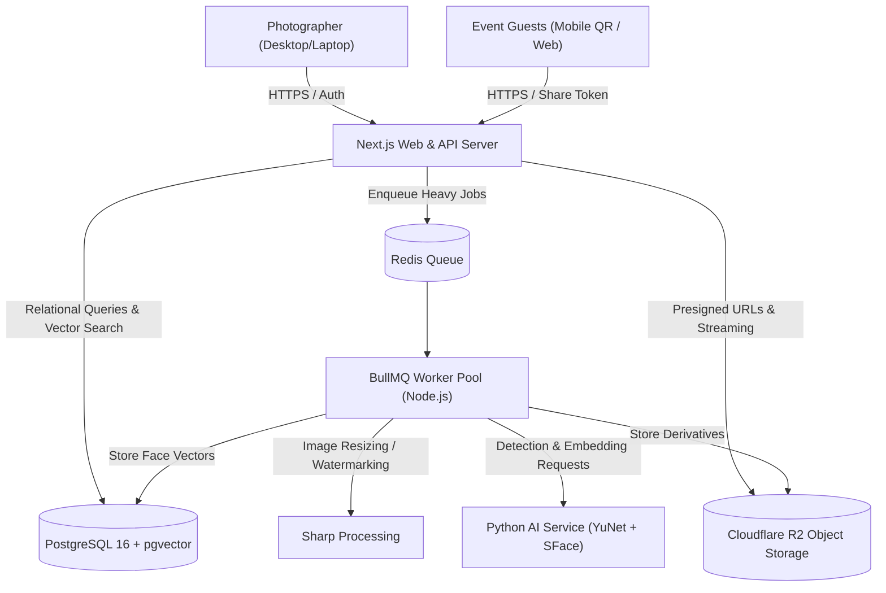

# ADR-001: Overall System Architecture

## Status
Accepted

## Context
The platform is an exclusive, private photography gallery management and AI face-search platform engineered for a single professional photographer. The system must handle demanding professional workloads (uploading batches of 5,000+ high-resolution photos, concurrent guest galleries with up to 500 simultaneous face searches), while avoiding unnecessary distributed systems, microservices bloat, multi-tenant billing overhead, or Kubernetes infrastructure.

## Decision
We select a **modular service-oriented architecture** comprising four tightly coordinated components:

1. **Web & API Application (Next.js / Node.js TypeScript):**
   - Serves both the authenticated Photographer Dashboard (`/dashboard`) and the public, accountless Guest Gallery (`/gallery/[shareToken]`).
   - Implements RESTful API endpoints, authorization middleware, input validation, and media orchestration.

2. **Database & Vector Store (PostgreSQL 16+ with `pgvector`):**
   - Single relational database housing photographer profile, events, ceremony folders, media asset records, job history, and 128-dimensional biometric face embeddings.
   - Uses HNSW / IVFFlat vector indexing for sub-10ms event-scoped cosine similarity queries.

3. **Background Job Queue & Workers (Redis + BullMQ):**
   - Asynchronous worker pool processing CPU-intensive operations: Sharp image derivatives (thumbnails, previews, watermarks), video packaging, bulk ZIP creation, and maintenance sweeps.

4. **Dedicated AI Facial Inference Service (Python / OpenCV YuNet + SFace):**
   - Lightweight, fast Python micro-service communicating over local HTTP/gRPC. Loads neural models once into memory; executes face detection, alignment, and 128-D vector extraction.

5. **Cloud Object Storage (Cloudflare R2):**
   - S3-compatible primary storage owned directly by the photographer with zero egress fees.

## Alternatives Considered
- **All-in-One Monolith without Workers:** Rejected. Processing 5,000 photos synchronously on the API server would exhaust event-loop memory, drop HTTP connections, and block interactive guest face-search requests.
- **Microservices with Kubernetes & Kafka:** Rejected. Grossly over-engineered for a single-photographer deployment; introduces extreme DevOps complexity, high hosting costs, and distributed transaction failure modes.
- **Serverless Functions for Everything:** Rejected. Serverless execution times out on large ZIP generation; cold starts severely degrade facial recognition latency; Python AI model initialization cannot tolerate serverless cold boots.

## Consequences
- **Positive:** Maximum operational simplicity; clear separation between interactive web traffic and heavy media/AI processing; zero egress fees on Cloudflare R2; predictable hosting on a single standard VPS or container instance.
- **Negative:** Requires running two runtime environments (Node.js and Python) alongside Redis and PostgreSQL.
