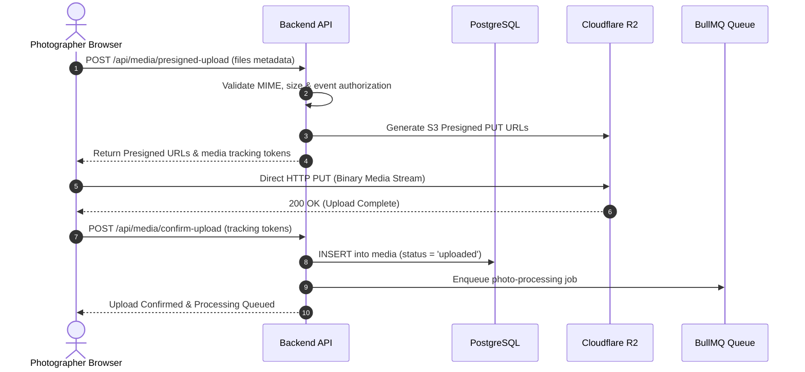

# ADR-006: Cloudflare R2 Storage Architecture

## Status
Accepted

## Context
High-resolution wedding and event photography requires hundreds of gigabytes or terabytes of object storage. Traditional cloud providers (AWS S3, Google Cloud Storage) charge exorbitant egress fees when thousands of guests browse high-resolution galleries and download original files. Furthermore, the product requires direct photographer ownership without artificial storage quota markups.

## Decision
We select **Cloudflare R2 Object Storage** with direct photographer ownership and deterministic object keys:

### 1. Direct Ownership & Zero Egress
- The photographer provisions an R2 bucket in their personal Cloudflare account.
- The photographer pays Cloudflare directly ($0.015/GB-month storage, **$0.00 egress data transfer**).
- The application NEVER sells artificial storage plans (e.g., "50GB plan"). The dashboard displays actual, measured byte consumption.

### 2. Deterministic Key Layout
Object keys adhere strictly to an event-partitioned hierarchy:
```
events/{event_id}/originals/{filename}     # Untouched original master
events/{event_id}/previews/{filename}      # 1600px optimized WebP/JPEG (optional watermark)
events/{event_id}/thumbnails/{filename}    # 400px optimized WebP grid image
events/{event_id}/videos/{filename}        # Video master asset
```

### 3. Database-Driven Folder Organization (Critical Decision)
Ceremony folders (e.g., *Haldi*, *Mehndi*, *Wedding Ceremony*, *Reception*) **DO NOT** appear in Cloudflare R2 object keys.
- **Reasoning:** Moving 2,000 photos from "Uncategorized" to "Reception" in a key-based hierarchy requires 2,000 copy operations followed by 2,000 delete operations in R2, risking partial failure and rate-limiting.
- **Our Architecture:** Folder assignment is stored exclusively in the relational database (`media.folder_id = :folder_id`). Reorganizing photos between folders is an instantaneous single SQL update taking < 5ms with zero storage I/O.

### 4. Direct Client-to-R2 Uploads via Pre-Signed URLs
Large media files never proxy through the application server:
1. Photographer browser requests upload authorization from the API server.
2. API validates file metadata, checks event authorization, and generates a pre-signed S3 `PutObject` URL valid for 30 minutes.
3. Photographer browser uploads the binary file directly to Cloudflare R2 via HTTP PUT with progress tracking.
4. On upload completion, browser notifies API server (`/api/media/confirm-upload`), which creates the media record and enqueues background processing.



### 5. Storage Measurement & Reconciliation
- The database tracks byte sizes for originals, previews, and thumbnails.
- A nightly background reconciliation job runs `ListObjectsV2` with prefix `events/{event_id}/` to verify byte totals and detect orphaned files.
- The dashboard provides direct links to Cloudflare:
  - R2 Dashboard: `https://dash.cloudflare.com/:account_id/r2/default/buckets/:bucket_name`
  - Cloudflare Billing: `https://dash.cloudflare.com/:account_id/billing`

## Alternatives Considered
- **Proxying Uploads Through Express/Next.js Application Server:** Rejected. Uploading batches of 500+ RAW photos (15GB+) through the web server consumes extreme memory, hits server request timeouts, and starves network bandwidth.
- **AWS S3:** Rejected. AWS egress fees ($0.09/GB) would cost the photographer hundreds of dollars per event when hundreds of guests view and download galleries. Cloudflare R2 has $0 egress fees.

## Consequences
- **Positive:** Zero cloud egress costs; lightning-fast direct browser uploads; zero upload bottleneck on the web server; instantaneous folder reassignments.
- **Negative:** Requires CORS configuration on the Cloudflare R2 bucket to allow direct browser PUT requests.
