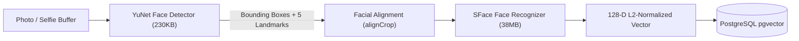

# ADR-007: AI Face Recognition & Biometric Architecture

## Status
Accepted

## Context
The platform's core guest feature is **"Find My Photos"**, enabling event guests to locate every photo they appear in by capturing a selfie on their mobile device. The AI engine must detect multiple faces in group photos, align facial landmarks, extract dense vector embeddings, and support sub-second search across thousands of event photos while strictly protecting guest biometric privacy.

## Decision
We select **OpenCV YuNet + SFace** running in a dedicated **Python Micro-Service**:

### 1. Model Selections & Specifications
- **Face Detection (YuNet):**
  - ONNX Model: `face_detection_yunet_2023mar.onnx` (OpenCV Zoo).
  - Lightweight CNN (~230 KB), sub-30ms CPU inference.
  - Detects all faces in complex compositions (crowds, angled lighting, profile views).
  - Outputs bounding boxes `[x, y, w, h]`, 5 facial landmarks (right eye, left eye, nose tip, right mouth, left mouth), and confidence score.
  - Score threshold: 0.70; NMS threshold: 0.30.
- **Face Recognition & Alignment (SFace):**
  - ONNX Model: `face_recognition_sface_2021dec.onnx` (OpenCV Zoo).
  - Deep neural network (~38 MB), sub-50ms CPU inference.
  - Aligns face using detected 5 landmarks (`alignCrop`).
  - Outputs a **128-dimensional L2-normalized vector embedding**.
  - Metric: Cosine similarity (`dot product` of normalized vectors, range -1.0 to 1.0).
  - Calibrated Match Threshold: Cosine similarity >= 0.62 (or cosine distance <= 0.38).

### 2. Micro-Service Architecture
The AI engine runs as a persistent Python service (FastAPI / Uvicorn) on `127.0.0.1:8000`:
- **Model Warmth:** Neural networks are loaded into memory once on startup; zero cold-start penalty per request.
- **Batch Endpoint:** `/detect-and-embed` accepts image path/buffer, returns JSON array of all detected faces and 128-D vectors.
- **Transient Selfie Endpoint:** `/embed-selfie` accepts ephemeral selfie buffer in RAM, returns normalized 128-D vector, and unlinks memory immediately.

### 3. Group Photo Matching (Core Requirement)
- In a photo with multiple individuals (e.g., 8 people in a bridal party), YuNet detects 8 distinct faces.
- SFace produces 8 independent embedding records in `face_embeddings`, all pointing to the single `photo_id`.
- If an event guest matches Face #4, the query `SELECT photo_id FROM face_embeddings WHERE ...` returns the parent `photo_id`.
- The complete group photograph is returned in the guest's search results.

### 4. Biometric Zero-Retention Protocol
Guest selfies are treated as sensitive biometric data:
1. Captured via client webcam or device file picker.
2. Ingested ephemerally into server RAM (or temporary encrypted scratch file).
3. Converted into 128-D mathematical vector coordinates.
4. Raw selfie is **permanently destroyed/unlinked** within milliseconds.
5. No raw guest selfies are ever written to Cloudflare R2 or persistent databases.

## Alternatives Considered
- **Face-api.js / TensorFlow.js in Node:** Evaluated, but TensorFlow.js Node bindings suffer from compatibility instability across Node 20–24 on various operating systems. Python OpenCV provides native C++ inference, 3x faster execution, and rock-solid cross-platform stability.
- **Third-Party Biometric Cloud APIs (AWS Rekognition / Face++):** Rejected. Exorbitant per-image API costs on large photography events; sends client biometric data to third-party corporate clouds; violates privacy principles.

## Consequences
- **Positive:** Zero third-party API costs; ultra-low latency (< 100ms total inference); complete privacy control; real deep-learning accuracy.
- **Negative:** Requires running Python runtime alongside the Node.js application.
