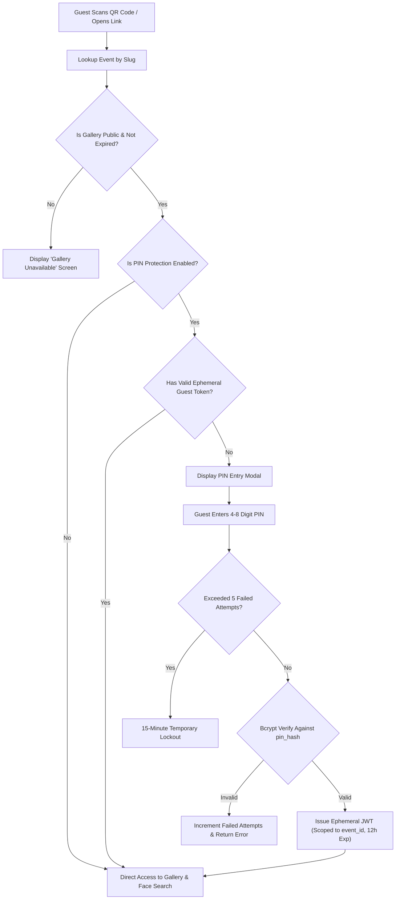

# ADR-008: Guest Authorization & Access Model

## Status
Accepted

## Context
Event guests access galleries via physical QR codes printed on table cards or via shareable messaging links. Forcing guests to register, create accounts, verify emails, or remember passwords creates extreme friction and kills event participation. However, photographers must have the option to restrict galleries to invited guests using an event PIN, while ensuring that guests can never navigate outside their authorized event.

## Decision
We select an **Accountless Ephemeral Session Model**:

### 1. Zero-Registration Access Flow
Guests access galleries strictly via unique URL slugs (`/gallery/:shareToken`):


### 2. Ephemeral Guest Token Specification
When PIN verification succeeds, the backend issues an ephemeral signed JWT:
```json
{
  "eventId": "9b1deb4d-3b7d-4bad-9bdd-2b0d7b3dcb6d",
  "scope": "guest_gallery_access",
  "iat": 1775630400,
  "exp": 1775673600
}
```
- Stored on the client in `sessionStorage` or local memory.
- Transmitted in the request header: `X-Guest-Token: <token>`.
- **Strict Scope Enforcement:** The guest token grants access ONLY to endpoints where `:eventId` matches `token.eventId`. It provides zero access to photographer dashboard endpoints or other events.

### 3. Brute-Force Rate Limiting
- Keyed by `ip_address:event_id`.
- Tracked in Redis (or in-memory rate limiter).
- Max 5 failed attempts per 15-minute sliding window.
- Returns `HTTP 429 Too Many Requests` with friendly countdown timer.

## Alternatives Considered
- **Guest Accounts with Email Magic Links:** Rejected. Violates core requirement: "Guests DO NOT have accounts, DO NOT register, DO NOT login."
- **Client-Side PIN Check (Storing PIN in JavaScript):** Rejected. Critical security violation; anyone inspecting browser developer tools could read the PIN.
- **Permanent Browser Cookies for PIN:** Rejected. Leaves guest sessions open indefinitely on shared family devices. Ephemeral 12-hour session is optimal.

## Consequences
- **Positive:** Zero friction for guests; mobile-first speed; strong brute-force defense; strictly event-isolated guest tokens.
- **Negative:** Guests returning after 12 hours to a PIN-protected gallery must re-enter the PIN.
