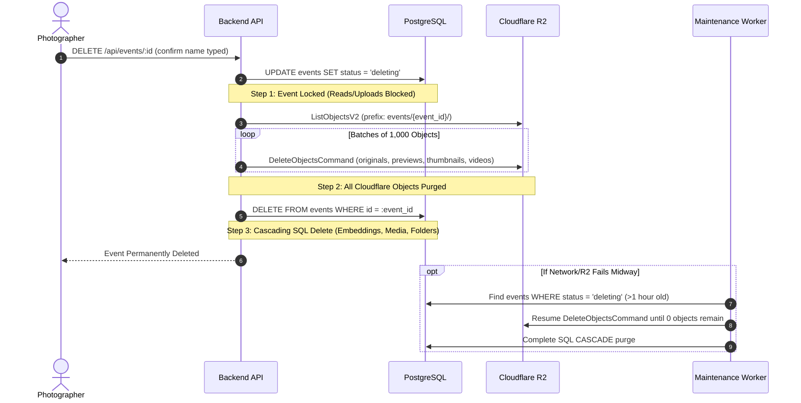

# ADR-012: Deletion Protocol & Cross-System Data Consistency

## Status
Accepted

## Context
Permanent gallery deletion is a destructive, irreversible operation. Because the platform spans a relational database (PostgreSQL), background job queues (Redis), and cloud object storage (Cloudflare R2), a standard SQL transaction cannot span across Cloudflare R2. If an R2 deletion fails halfway through, an application could leave thousands of orphaned files in Cloudflare R2 incurring unnecessary storage costs, or conversely, delete R2 files while retaining orphaned database records.

## Decision
We select a **Two-Phase Soft-Lock & Cascading Purge Protocol with Orphan Reconciliation**:



### 1. Step 1: Transition to `deleting` State (Soft-Lock)
- The event status is updated to `status = 'deleting'`.
- This immediately locks the event: all guest gallery endpoints return `HTTP 404`, all active upload authorizations are rejected, and any pending BullMQ background jobs for this event are aborted.

### 2. Step 2: Cloudflare R2 Object Purge
- The server queries `ListObjectsV2` for prefix `events/{event_id}/`.
- Deletes objects in batches of up to 1,000 keys using S3 `DeleteObjectsCommand`.
- Deletes originals, previews, thumbnails, videos, and export ZIPs.

### 3. Step 3: Relational Cascade Delete
- Once R2 confirms zero remaining objects, the server executes:
  ```sql
  DELETE FROM events WHERE id = :event_id;
  ```
- Because foreign keys are configured with `ON DELETE CASCADE`:
  - `folders` rows are deleted.
  - `media` rows are deleted.
  - `face_embeddings` vector rows are deleted.
  - `processing_jobs` rows are deleted.

### 4. Partial Failure Recovery & Orphan Reconciliation
- If a network partition or power failure interrupts Step 2, the event remains in `status = 'deleting'`.
- The nightly maintenance worker (`queue:maintenance`) queries all events where `status = 'deleting'` for more than 1 hour, resumes R2 object deletion, and finalizes the database cascade.
- This guarantees zero orphaned R2 files and zero database inconsistencies.

### 5. Safe Folder Deletion Contrast
- **Deleting an Event:** Destructive cascade that purges all media and files.
- **Deleting a Folder:** Non-destructive reorganization:
  ```sql
  -- Safe: Reassigns photos to default pool or specified destination
  UPDATE media SET folder_id = $target_folder_id WHERE folder_id = $deleting_folder_id;
  DELETE FROM folders WHERE id = $deleting_folder_id;
  ```
  Photos and their R2 files are **NEVER deleted** when a ceremony folder is removed.

## Alternatives Considered
- **Deleting Database Records First, Then R2 Files:** Rejected. If the server crashes after deleting database records, the R2 storage keys are lost forever, leaving permanent orphaned files that the photographer would continue paying Cloudflare for indefinitely.
- **Immediate Hard Delete in a Single Synchronous Request:** Rejected. Deleting 5,000 photos across R2 in a single synchronous HTTP request will exceed web server gateway timeouts (30s) and crash the request.

## Consequences
- **Positive:** Zero orphaned files; complete transaction safety across distributed systems; clear recovery path for network failures; safe folder reorganization.
- **Negative:** Large gallery deletions take several seconds to process through R2 batch deletion.
