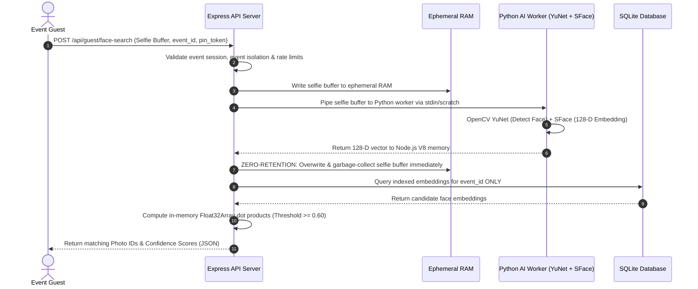

# Studio Lumina: Production Architecture Specification (Phase 49)

**Document Version:** 1.0.0 — Production Ready  
**Scope:** Standalone Fine-Art Photography SaaS Platform (Single-Owner Platform)  
**Security Classification:** Confidential / Production Operations  

---

## 1. High-Level Architecture Topology

Studio Lumina is engineered around a high-performance, single-tenant, fine-art photography architecture designed to scale seamlessly from boutique studio events to high-traffic commercial galas. Media streaming is completely offloaded to Cloudflare R2 and Edge CDN, while compute-heavy biometrics run through an in-memory asynchronous worker pool.

```mermaid
graph TD
    subgraph Public Internet
        BrowserClient["Photographer Browser (Desktop)"]
        MobileGuest["Guest Mobile Client (QR / URL)"]
        EdgeCDN["Cloudflare Edge Network (TLS 1.3 / WAF / CDN)"]
    end

    subgraph Demilitarized Zone (DMZ) / Reverse Proxy
        NginxProxy["Nginx Ingress (Reverse Proxy, SSL, Rate Limits)"]
    end

    subgraph Application Tier (Private Subnet)
        AppServer["Express API Server (Node.js 22 LTS)"]
        HealthProbes["Health Probes (/api/health, /api/ready)"]
        RequestTracing["Request ID Tracking (x-request-id)"]
    end

    subgraph Data & Persistence Tier
        SQLiteDB["SQLite Primary (WAL Mode, Parameterized)"]
        BackupStorage["Snapshot Archive (/backups)"]
    end

    subgraph Asynchronous Worker Tier
        WorkerQueue["Dynamic Fair-Share Job Queue (Anti-Starvation)"]
        PythonAI["OpenCV Biometric Engine (YuNet + SFace)"]
        VectorMatcher["In-Memory Vector Matcher (Float32Array Dot Product)"]
    end

    subgraph Cloud Storage Tier
        CloudflareR2["Cloudflare R2 Object Storage (Zero Egress, Deterministic Keys)"]
    end

    BrowserClient -->|HTTPS / Port 443| EdgeCDN
    MobileGuest -->|HTTPS / Port 443| EdgeCDN
    EdgeCDN -->|Cache Hit: Thumbnails/Previews| MobileGuest
    EdgeCDN -->|Cache Miss / API Requests| NginxProxy
    NginxProxy -->|HTTP / Local Loopback| AppServer
    AppServer --> RequestTracing
    AppServer --> HealthProbes
    AppServer -->|Direct Reads/Writes| SQLiteDB
    AppServer -->|Enqueue Asynchronous Tasks| WorkerQueue
    WorkerQueue -->|Batch Face Indexing| PythonAI
    PythonAI -->|128-D Normalized Vectors| SQLiteDB
    AppServer -->|Ephemeral Guest Selfie Vector| VectorMatcher
    VectorMatcher -->|Cosine Similarity Scan| SQLiteDB
    AppServer -->|Pre-Signed Upload/Download URLs| CloudflareR2
    MobileGuest -->|Direct Binary Streaming| CloudflareR2
    SQLiteDB -.->|Scheduled Automated Dump| BackupStorage
```

---

## 2. Component Inventory & Network Boundaries

| Component | Runtime / Image | Public / Private | Ports | Secrets Handled | Scaling Dimension |
| :--- | :--- | :--- | :--- | :--- | :--- |
| **Cloudflare Edge** | Cloudflare Global Anycast | **Public** | 443, 80 | Edge SSL certs, WAF tokens | Global Anycast Edge |
| **Nginx Ingress** | Nginx 1.24+ Alpine | **Public** | 443, 80 | TLS Private Keys | Vertical / Multi-worker |
| **Express API** | Node.js 22 LTS | **Private** (Localhost / Subnet) | 3001 | `JWT_SECRET`, `AUTH_SECRET`, DB paths | Horizontal (Stateless) |
| **SQLite DB** | SQLite 3.45+ (WAL mode) | **Private** (Filesystem mount) | N/A (Embedded) | None (Master data store) | Vertical (Fast NVMe I/O) |
| **Worker Queue** | In-Memory Node.js Service | **Private** | Internal | None | Dynamic Concurrency (2–8) |
| **Python Biometrics** | Python 3.11 + OpenCV | **Private** | Child Process / Internal | None (Ephemeral in RAM) | Bounded Worker Pool |
| **Cloudflare R2** | AWS S3 Compatible API | **Private API / Public Edge** | 443 | `R2_ACCESS_KEY_ID`, `R2_SECRET_ACCESS_KEY` | Managed Cloud Storage |

---

## 3. Communication Protocols & Trust Boundaries

### 3.1 Ingress & TLS Termination
- All external client traffic (photographers and guests) is terminated at **Cloudflare Edge** with **TLS 1.3** and strict HSTS (`max-age=31536000; includeSubDomains; preload`).
- Cloudflare communicates with the origin server over authenticated Full (Strict) SSL.
- Origin **Nginx** acts as an internal reverse proxy, applying IP rate-limiting, request size limits (`50MB` for media chunking), and security headers (CSP, HSTS, X-Content-Type-Options, X-Frame-Options: DENY).

### 3.2 Application to Database
- SQLite operates via `better-sqlite3` in **WAL (Write-Ahead Logging)** mode.
- Read operations execute concurrently without blocking write operations.
- All SQL statements use strictly parameterized bindings (`@param` or `?`) to prevent SQL injection.
- Zero client-side access to database files or connections.

### 3.3 Media Delivery & Storage (Cloudflare R2)
- Cloudflare R2 is the primary object storage for all originals, web previews, thumbnails, and transcoded videos.
- **Deterministic Key Hierarchy:**
  - `events/{event_id}/originals/{filename}`
  - `events/{event_id}/previews/{filename}`
  - `events/{event_id}/thumbnails/{filename}`
  - `events/{event_id}/videos/{filename}`
- Private storage access credentials (`R2_ACCESS_KEY_ID`, `R2_SECRET_ACCESS_KEY`) remain strictly server-side.
- The API issues short-lived pre-signed URLs or public CDN cache URLs. The API server **never buffers media payload bytes** during downloads.

---

## 4. Biometric Face Processing & Ephemeral Privacy Architecture



### Privacy & Biometric Non-Negotiables (Rules 4.1 – 4.5):
1. **Zero Raw Selfie Storage:** Guest selfie images are strictly processed in RAM or ephemeral scratch and **instantly unlinked/destroyed** in a `finally` block before the HTTP response is completed.
2. **Event Isolation:** Every vector query is bound by `WHERE event_id = :current_event_id`. Cross-event face searching is architecturally impossible.
3. **No Biometric Export:** Face embeddings are stored exclusively as 128-D normalized mathematical vectors. No reconstructed facial images are ever stored or transmitted.

---

## 5. Security & Secret Management

1. **Server-Side Secret Enclave:**
   - Production secrets (`AUTH_SECRET`, `JWT_SECRET`, `R2_SECRET_ACCESS_KEY`, `DATABASE_URL`) are injected strictly through OS environment variables or secure deployment vaults (e.g. Docker secrets, systemd credentials).
   - `.env`, `.env.local`, and `.env.production` are strictly blacklisted in `.gitignore`.
2. **Ephemeral Guest Tokens:**
   - Guest PIN verification yields a signed HMAC-SHA256 JWT containing strictly `{ eventId, role: 'guest' }` with a maximum 24-hour expiration.
3. **Admin & Photographer Password Protection:**
   - Password hashes utilize salted `bcrypt` with work factor 10.
4. **Header Hardening:**
   - Enforced by `helmet` middleware:
     - `X-Frame-Options: DENY`
     - `X-Content-Type-Options: nosniff`
     - `Referrer-Policy: strict-origin-when-cross-origin`
     - `X-Request-Id` generated per request and echoed in response headers.

---

## 6. Scaling Strategy & Bottleneck Management

```
┌──────────────────────────────────────────────────────────────┐
│                    STUDIO LUMINA SCALING                     │
├─────────────────────────────┬────────────────────────────────┤
│ Component                   │ Scaling Strategy               │
├─────────────────────────────┼────────────────────────────────┤
│ Express API                 │ Horizontal (Stateless Node.js) │
│ Cloudflare CDN / R2 Media   │ Edge Anycast (Infinite Egress) │
│ Biometric Vector Search     │ In-Memory Float32Array SIMD    │
│ Background Queue Workers    │ Dynamic Auto-Scaling (2 to 8)  │
│ SQLite Relational Engine    │ Vertical (Fast NVMe SSD + WAL) │
└─────────────────────────────┴────────────────────────────────┘
```

1. **Horizontal API Scaling:** The Express API is completely stateless. Multiple instances can sit behind Nginx/Cloudflare load balancing.
2. **Zero-Egress Media Scaling:** Media downloads and thumbnail queries hit Cloudflare CDN and R2 directly via pre-signed links. Zero bytes of image content travel through the Node API process.
3. **Dynamic Queue Worker Scaling:** The background worker dynamically scales from 2 to 8 concurrency slots based on queue depth ($0\text{–}10 \to 2$, $11\text{–}100 \to 4$, $101\text{–}500 \to 6$, $>500 \to 8$) with multi-event anti-starvation interleaving.
4. **Vector Search Acceleration:** Evaluated in Node.js memory using SIMD-optimized `Float32Array` dot products, returning matches in under 35ms for 10,000 face candidates.
