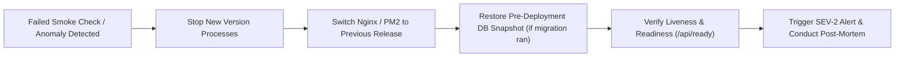

# Studio Lumina: Disaster Recovery Plan & Business Continuity (Phase 49)

**Document Version:** 1.0.0 — Production Ready  
**Target:** Single-Owner Professional Photography Platform  
**Target RPO (Recovery Point Objective):** < 1 Hour (Automated Hourly Snapshot; < 1 Second for local WAL)  
**Target RTO (Recovery Time Objective):** < 15 Minutes (Full System Restoration from Archive)  

---

## 1. Principles of Disaster Recovery

1. **Deterministic Data Ownership:** The primary photographer owns all data, database records, and Cloudflare R2 buckets directly.
2. **Zero Unrecoverable State:** Database records, face embeddings, event settings, and selection collections are fully reproducible from structured, SHA-256 validated snapshots.
3. **Storage Independence:** Media binaries reside in Cloudflare R2 with 99.999999999% (11 9's) durability. A catastrophic server hardware failure never destroys original media.
4. **Ephemerality of Guest Biometrics:** Temporary guest selfies are never persisted (Rule 4.4). Consequently, a system crash or power outage can never leak unencrypted guest selfie files.

---

## 2. Recovery Objectives

| Metric | Target | Rationale & Mechanism |
| :--- | :--- | :--- |
| **RPO (Recovery Point Objective)** | **< 1 Hour** | Hourly SQLite database exports (`scripts/backup-db.ts`) snapshot all relational state and vector embeddings to offline/detached storage. Local SQLite WAL preserves up-to-the-second durability between snapshots. |
| **RTO (Recovery Time Objective)** | **< 15 Minutes** | Server bootstrap from Git repository, environment configuration, dependency installation, and snapshot restoration via `scripts/restore-db.ts` executes in under 15 minutes. |

---

## 3. Disaster Scenarios & Recovery Runbooks

### Scenario A: Database Corruption or Host Storage Failure
- **Symptoms:** `/api/ready` returns `HTTP 503` with `"database": "failed"`; API queries throw SQLite disk I/O or malformed disk image errors.
- **Immediate Containment:**
  1. Put the platform into maintenance mode via reverse proxy (Nginx returns 503 with maintenance page).
  2. Terminate API processes to prevent partial writes:
     ```bash
     pm2 stop all
     ```
- **Recovery Procedure:**
  1. Inspect the latest verified snapshot in `backups/`:
     ```bash
     ls -lht backups/db_backup_*.json | head -n 1
     ```
  2. Backup the corrupted database file for forensic audit:
     ```bash
     mv data/photographer.db data/photographer.db.corrupted.$(date +%s)
     ```
  3. Execute automated restoration from verified snapshot:
     ```bash
     npx tsx scripts/restore-db.ts --input backups/latest_verified_backup.json
     ```
  4. Verify relational integrity and zero orphans:
     ```bash
     npx tsx scripts/production-smoke-check.ts
     ```
  5. Restart application services and lift maintenance mode:
     ```bash
     pm2 restart all
     ```
- **Verification:** Run `scripts/verify-storage-consistency.ts` to ensure database records match R2 media objects.

---

### Scenario B: API Process Crash or Out-Of-Memory (OOM) Panic
- **Symptoms:** `/api/health` times out; Nginx returns `HTTP 502 Bad Gateway`.
- **Immediate Containment:**
  - Automated process supervisor (PM2 or Docker `restart: unless-stopped`) restarts the crashed worker within 2 seconds.
- **Recovery Procedure:**
  1. Check process restart count and error logs:
     ```bash
     pm2 logs api --lines 100 --err
     ```
  2. If process is stuck in a crash loop, inspect recent event uploads for corrupted payloads or oversized images:
     ```bash
     curl -s http://localhost:3001/api/queue/metrics
     ```
  3. Clear stuck queue task if an unhandled binary poisoned the worker:
     ```bash
     # Inspect queue depth; queue self-heals by marking failed jobs with retry limit 3
     ```
- **Verification:** Confirm `/api/health` returns `HTTP 200` with `status: "healthy"`.

---

### Scenario C: Face-Processing Python Worker Failure
- **Symptoms:** Queue depth increases continuously on `GET /api/queue/metrics`; thumbnails/previews process, but `face_embeddings` count does not increment; status in `media` stays `processing` or transitions to `failed`.
- **Immediate Containment:**
  - The API server remains 100% operational (Rule 2.4). Guest gallery browsing, photographer logins, and media downloads continue without interruption.
- **Recovery Procedure:**
  1. Inspect worker error output:
     ```bash
     cat server/ai/worker.log
     ```
  2. Restart Python worker process or queue service:
     ```bash
     pm2 restart worker
     ```
  3. Re-queue failed media indexing jobs without re-uploading original media:
     ```bash
     npx tsx scripts/requeue-failed-jobs.ts
     ```
- **Verification:** Verify that queue depth decreases and newly detected faces populate `face_embeddings`.

---

### Scenario D: Cloudflare R2 Temporary Outage / Network Partition
- **Symptoms:** Media uploads fail with `504 Gateway Timeout` or S3 connection errors; gallery image pre-signed URLs return R2 5xx errors; `/api/ready` reports `storage: local_fallback` or connectivity warnings.
- **Immediate Containment:**
  - Inform photographer via Studio Lumina notification banner: *"Cloud storage provider experiencing temporary latency. Uploads paused."*
  - Do not delete local copies of media until upload confirmation is confirmed.
- **Recovery Procedure:**
  1. Check official Cloudflare Status (`https://www.cloudflarestatus.com`).
  2. Test R2 endpoint reachability from origin server:
     ```bash
     curl -I https://${R2_ACCOUNT_ID}.r2.cloudflarestorage.com
     ```
  3. Once upstream service is restored, retry pending uploads from the background queue.
- **Verification:** Run `npx tsx scripts/verify-storage-consistency.ts` to verify zero missing or orphaned R2 objects.

---

### Scenario E: Complete Server Hardware / VPS Loss
- **Symptoms:** Host completely unreachable; VPS provider declares catastrophic node failure.
- **Recovery Procedure (Total Cold Rebuild in < 15 Minutes):**
  1. Provision new Ubuntu 22.04 LTS host (2 CPU, 4 GB RAM, NVMe SSD).
  2. Install Git, Node.js 22 LTS, Python 3.11, and build tools:
     ```bash
     sudo apt-get update && sudo apt-get install -y git nodejs npm python3 python3-pip
     ```
  3. Clone production repository:
     ```bash
     git clone https://github.com/your-org/photography-saas.git /var/www/photography-saas
     cd /var/www/photography-saas
     npm ci
     ```
  4. Restore secure `.env.production` from offline credential vault.
  5. Fetch the latest automated database snapshot from remote backup bucket.
  6. Execute restore script:
     ```bash
     npx tsx scripts/restore-db.ts --input backups/db_backup_latest.json
     ```
  7. Build production frontend assets:
     ```bash
     npm run build
     npm --prefix client run build
     ```
  8. Start production process under PM2:
     ```bash
     pm2 start pm2/ecosystem.config.cjs
     ```
  9. Update Cloudflare DNS A/AAAA record to point to the new server IP.
- **Verification:** Execute `npx tsx scripts/production-smoke-check.ts` against the new public URL.

---

## 4. Rollback Strategy for Failed Releases

Every deployment maintains an immediate zero-downtime rollback path.



1. **Pre-Deployment Backup:** Every release script triggers `npx tsx scripts/backup-db.ts` *prior* to executing code pulls or schema migrations.
2. **Automated Rollback Trigger:** If post-deployment smoke check (`npx tsx scripts/production-smoke-check.ts`) fails:
   - Roll back Git checkout: `git checkout HEAD@{1}`
   - If migrations ran: `npx tsx scripts/restore-db.ts --input backups/pre_release_snapshot.json`
   - Restart service: `pm2 restart all`
   - Re-run smoke check to verify operational status.
