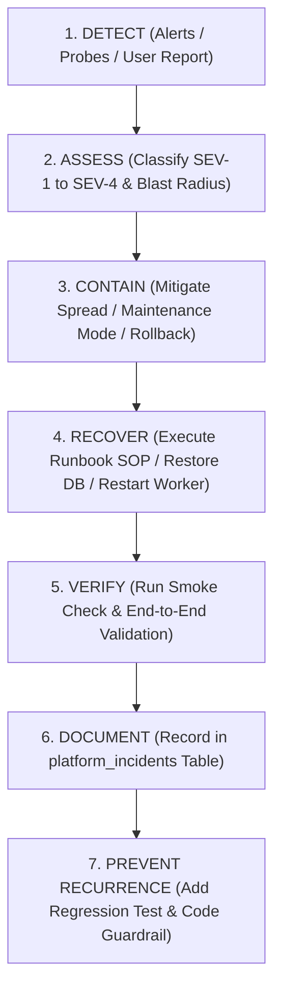

# Studio Lumina: Incident Response & Triage Framework (Phase 49)

**Document Version:** 1.0.0 — Production Ready  
**Scope:** Production Reliability, Severity Classification & Escalation Matrix  

---

## 1. Incident Severity Classification Matrix

| Severity Level | Definition | Examples | SLA (Response) | Escalation |
| :--- | :--- | :--- | :--- | :--- |
| **SEV-1 (Critical)** | Complete platform outage, active data corruption risk, or verified security/biometric breach. | • Total API downtime (502/503)<br>• Database corruption<br>• Cloudflare R2 bucket inaccessible<br>• Unauthenticated guest accessing another event's media | **< 15 Minutes** | Immediate notify photographer/admin; enable maintenance mode. |
| **SEV-2 (Major)** | Core workflow unavailable for multiple users, but platform remains partially online. | • Face search failing for all guests<br>• Batch uploads failing at 100% rate<br>• Client PIN verification failing<br>• Queue completely stalled | **< 30 Minutes** | On-call engineer mobilizes; review worker logs; restart queue. |
| **SEV-3 (Moderate)** | Secondary feature impaired; functional workaround exists. | • Bulk ZIP download export timeout<br>• Video transcoding delayed<br>• Selection proofing comment rendering bug<br>• Dashboard analytics lagging | **< 2 Hours** | Log incident in `platform_incidents`; address during standard hours. |
| **SEV-4 (Minor)** | Cosmetic UI issue or minor operational warning with zero data impact. | • Mobile CSS overflow on small screens<br>• Typo in email template<br>• Non-blocking deprecation log warning | **Next Release** | File ticket in backlog; schedule fix in next sprint. |

---

## 2. Seven-Stage Incident Lifecycle Workflow



### Stage 1: Detect
- Proactive detection via `/api/health`, `/api/ready`, `/api/queue/metrics`.
- Automated smoke check triggers alert on non-200 status codes.
- Exception logs surfaced through centralized JSON error handler.

### Stage 2: Assess & Classify
- Identify blast radius: Is the issue isolated to a single event or platform-wide?
- Classify according to the Severity Matrix above.
- Create an entry in `platform_incidents`:
  ```sql
  INSERT INTO platform_incidents (id, title, severity, status, affected_subsystem, description)
  VALUES ('inc-001', 'Cloudflare R2 Connection Timeout', 'SEV-1', 'INVESTIGATING', 'storage', 'Uploads returning 504 gateway timeout.');
  ```

### Stage 3: Contain
- If data corruption or security exposure is active, immediately activate maintenance mode:
  ```bash
  # Enable Maintenance Mode in DB
  sqlite3 data/photographer.db "UPDATE feature_flags SET enabled = 1 WHERE key = 'maintenance_mode';"
  ```
- If the issue followed a fresh release, initiate immediate rollback to previous stable commit.

### Stage 4: Recover
- Follow the corresponding procedure in [RUNBOOK.md](file:///c:/Users/Abhinav/OneDrive/Desktop/Photography-SaaS/docs/production/RUNBOOK.md).
- Restart hung processes or restore from verified database snapshot if corruption occurred.

### Stage 5: Verify
- Run the automated production smoke check:
  ```bash
  npx tsx scripts/production-smoke-check.ts
  ```
- Test real browser guest flow (event URL -> PIN -> Gallery -> Face Search -> Photo Download).

### Stage 6: Document & Close
- Update the incident status to `RESOLVED` with root cause and mitigation steps:
  ```sql
  UPDATE platform_incidents
  SET status = 'RESOLVED', resolved_at = datetime('now'), mitigation_steps = 'Restarted worker process and cleared stuck queue task.'
  WHERE id = 'inc-001';
  ```

### Stage 7: Prevent Recurrence
- Author a dedicated automated test in `tests/integration/` targeting the specific failure mode.
- Update documentation and runbooks to capture lessons learned.
