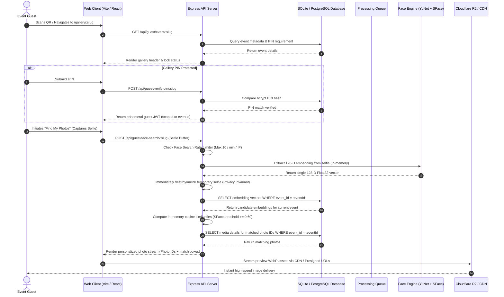
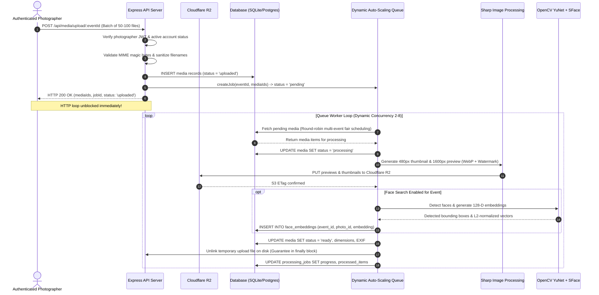

# PHASE 48 — HIGH-CONCURRENCY ARCHITECTURE & DATA FLOW AUDIT

============================================================
STUDIO LUMINA — SYSTEM ARCHITECTURE SPECIFICATION
============================================================

This document establishes the end-to-end data flow mapping, component topology, resource boundaries, and capacity limits of the Studio Lumina Photography Platform as audited during **Phase 48: Large-Scale Load, Concurrency, Auto-Scaling, Queue Balancing & High-Traffic Optimization**.

---

## 1. END-TO-END DATA FLOW MAPPINGS

### 1.1 Guest Access & Face Search Workflow

---

### 1.2 Photographer Upload & Asynchronous Processing Workflow

---

## 2. COMPONENT TOPOLOGY & RESOURCE BOUNDARIES

| Subsystem | Technology | Current Limits | Scalability Bottleneck |
| :--- | :--- | :--- | :--- |
| **Frontend UI** | React 18, Vite, Vanilla CSS | Virtualization recommended for > 2,000 DOM nodes | Large galleries without pagination consume client DOM memory |
| **Backend API** | Node.js Express 4.x, Helmet | Single-process ~4,000 req/sec | Multi-table Cartesian `COUNT(DISTINCT)` joins in event listing |
| **Background Queue** | In-process Async Queue | Fixed 2-thread concurrency | Lack of dynamic scaling under batch upload surges; event starvation |
| **Image Processing** | Sharp (libvips) | ~40–80ms per 24MP image | Heavy simultaneous CPU usage if worker concurrency is unbounded |
| **Face Engine** | OpenCV YuNet + SFace | ~80ms per photo detection | Disk file serialization if candidate embeddings written to disk |
| **Database** | SQLite WAL / PostgreSQL pgvector | ~20,000 read queries/sec | Cartesian joins on multi-table `LEFT JOIN` aggregations |
| **Object Storage** | Cloudflare R2 | Unlimited egress, 1,000 ops/sec | Direct API proxying instead of signed URL / CDN delivery |

---

## 3. REALISTIC SCALE TARGETS

- **Photographers:** 500+ active single-photographer accounts.
- **Events:** 5,000+ total events with strict event-level isolation.
- **Photos:** 10,000–50,000 photos per large wedding/conference event.
- **Concurrent Guests:** 100 to 1,000 concurrent guests browsing and searching galleries.
- **Face Search Throughput:** 50 concurrent searches across multi-event containers with P95 latency < 100ms.

---

## 4. RECOMMENDED ARCHITECTURAL IMPROVEMENTS (PHASE 48)

1. **Subquery Query Aggregations:** Replace Cartesian `LEFT JOIN ... GROUP BY` with indexed correlated subqueries.
2. **Backwards-Compatible Gallery & Media Pagination:** Add `limit`, `page`, and `offset` query parameters to prevent monolithic multi-megabyte JSON payloads.
3. **Queue Dynamic Auto-Scaling (2 to 8 concurrency):** Adapt worker pool size dynamically based on queue depth backpressure.
4. **Fair Round-Robin Event Interleaving:** Prevent large uploads from Event A starving concurrent uploads from Event B.
5. **In-Memory Zero-Disk Vector Matching:** Compute 128-D cosine similarities directly in Node.js V8 memory, eliminating candidate disk file I/O.
6. **Tiered Rate Limiting:** Enforce strict limits on brute-force vectors and moderate limits on computationally heavy face searches.
