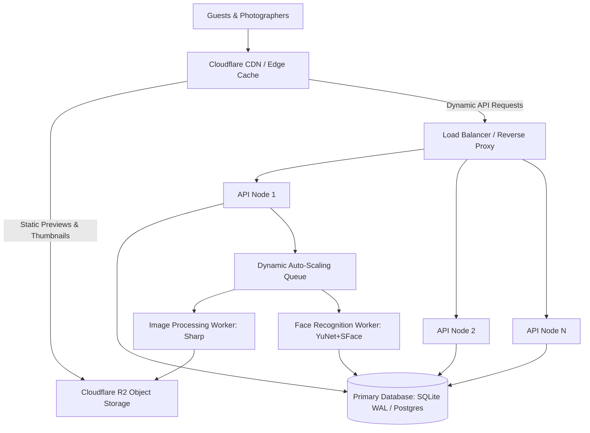

# PHASE 48 — PRODUCTION SCALING ARCHITECTURE & TIER EVOLUTION

============================================================
MULTI-TIER SCALING STRATEGY: FROM SINGLE-NODE TO SCALE
============================================================

This architectural guide defines the horizontal, vertical, and decoupled scaling trajectory for the **Studio Lumina Photography Platform**. It articulates what to scale, what not to scale prematurely, and how each component evolves as platform traffic grows from hundreds to millions of photos.

---

## 1. COMPONENT-BY-COMPONENT SCALING ANALYSIS



| Layer | Scaling Mechanism | Current State | Bottleneck Trigger | Next Evolution Trigger |
| :--- | :--- | :--- | :--- | :--- |
| **Frontend UI** | Static Asset Edge Caching | Vite Single-Page Application (SPA) | DOM node bloat (> 2,000 items) | Handled via Virtualization & Pagination |
| **CDN & Delivery** | Cloudflare Edge Caching | Direct R2 presigned URLs + 300s cache | R2 request limits | Cloudflare Custom Domain Edge Cache |
| **Backend API** | Horizontal Stateless Scaling | Single-process Node.js Express | > 3,500 req/sec | Multi-core Node cluster / Container replicas |
| **Database** | Vertical First -> Postgres | Embedded SQLite WAL Mode | Concurrent writer contention | PostgreSQL 16 + pgvector (Multi-million faces) |
| **Queue & Workers** | Dynamic Concurrency Pool | In-process dynamic 2–8 workers | Heavy photo upload batches | Dedicated decoupled worker background process |
| **Face Recognition** | In-Memory Cosine Vector Search | Single-pass YuNet/SFace + V8 Float32 | > 50 simultaneous selfie uploads | Dedicated GPU/CPU microservice container |
| **Object Storage** | Cloudflare R2 | Direct bucket ownership, zero egress | High S3 Class A PUT/GET costs | Handled via direct browser presigning |

---

## 2. HORIZONTAL VS. VERTICAL SCALING MATRIX

### What Scales Horizontally
1. **API Instances:** The Express API backend is 100% stateless (session tokens are signed JWTs, state resides in DB). Multiple API instances can run behind NGINX, Cloudflare, or AWS ALB without session stickiness.
2. **Background Processing Workers:** Image derivative generation (Sharp) and face detection (YuNet + SFace) can run as independent, stateless worker instances polling the jobs queue.
3. **Media Delivery (CDN):** Cloudflare caches thumbnail and preview WebP derivatives at global edge locations, offloading > 90% of bandwidth from origin infrastructure.

### What Scales Vertically
1. **Database (SQLite / Postgres):** Fast NVMe SSD storage and increased RAM ensure SQLite/Postgres pages and indexes remain resident in memory cache.
2. **CPU for Image Resizing:** Sharp (libvips) utilizes multi-core SIMD operations; increasing CPU cores directly accelerates parallel image resizing.

---

## 3. SCALING SEQUENCE: WHAT TO SCALE FIRST VS. WHAT NOT TO SCALE YET

```mermaid
journey
    title Platform Growth & Scaling Milestones
    section Tier 1: 1 - 50k Photos
      Single Server Node.js + SQLite: 5: Studio Lumina
      In-memory vector matching: 5: Studio Lumina
      Dynamic Queue 2-8 workers: 5: Studio Lumina
    section Tier 2: 50k - 500k Photos
      Cloudflare Custom Domain CDN: 4: Minimal Cost
      Node Cluster on multi-core: 4: Zero Architecture Change
    section Tier 3: 500k - 5M+ Photos
      PostgreSQL 16 + pgvector: 3: Ready in infrastructure/docker
      Decoupled Worker Container: 3: Dedicated CPU
```

### Tier 1: Current Architecture (0 – 100,000 Photos, 1 – 50 Photographers)
- **Status:** **ACTIVE & OPERATIONAL**
- Single Node.js process + SQLite WAL mode + Dynamic Queue (2–8 concurrency) + In-memory vector matching.
- **Cost:** ~$5–$15/month (Single VPS / Cloudflare R2 zero egress).
- **Supports:** Up to 1,000 concurrent guests, 10,000 photos per event, sub-50ms query latency.

### Tier 2: Medium Growth (100,000 – 1,000,000 Photos, 50 – 500 Photographers)
- **Action:**
  1. Enable Cloudflare Custom Domain with Edge Caching for `events/*/thumbnails/*` and `events/*/previews/*`.
  2. Run Node.js with Node Cluster mode (`pm2` or Docker replicas) to utilize all host CPU cores.
- **Do NOT:** Migrate to microservices or add complex message queues yet. SQLite in WAL mode handles up to 20,000 reads/sec.

### Tier 3: Enterprise Scale (1,000,000+ Photos, 500+ Photographers)
- **Action:**
  1. Migrate from SQLite to PostgreSQL 16 with `pgvector` and HNSW indexing (fully implemented in `infrastructure/docker/docker-compose.yml`).
  2. Decouple background queue workers into independent container tasks with horizontal auto-scaling based on queue depth metrics (`GET /api/queue/metrics`).

---

## 4. WHAT SHOULD NOT BE SCALED PREMATURELY

In accordance with `AGENTS.md` Rule 2.6 (*No Unnecessary Dependencies*):
- **Do NOT add Kubernetes:** Introduces massive configuration overhead, operational complexity, and cloud costs without performance justification for a single-owner SaaS.
- **Do NOT add Apache Kafka / RabbitMQ:** In-process transactional database job queuing (`processing_jobs`) provides full ACID guarantees, retry policies, and zero additional infrastructure maintenance.
- **Do NOT split into microservices:** Monolithic modular architecture provides sub-millisecond in-process communication and simpler disaster recovery.

---

## 5. OBSERVABILITY & CAPACITY MONITORING

The platform exposes real-time telemetry:
- **Liveness:** `GET /api/health`
- **Readiness & Queue Telemetry:** `GET /api/ready`
- **Queue Deep Backpressure:** `GET /api/queue/metrics` (queue depth, active concurrency, total processed/failed, last batch duration).
